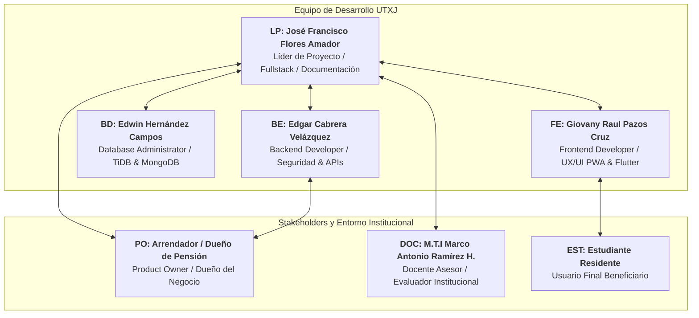
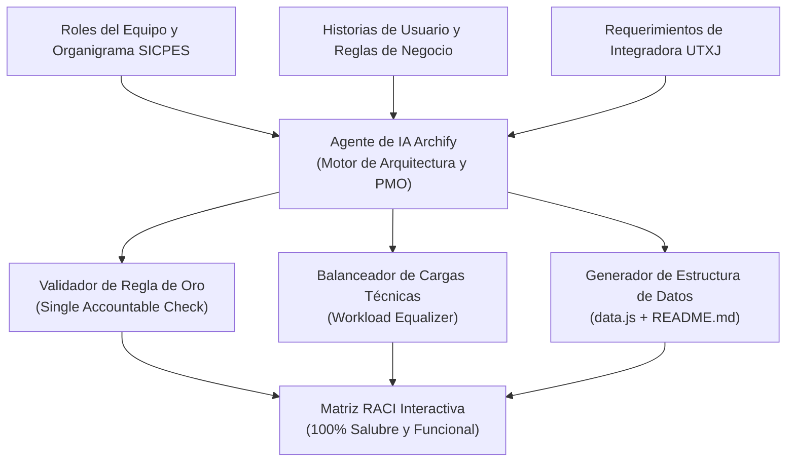

# Matriz RACI del Proyecto Integrador SICPES

> **Institución:** Universidad Tecnológica de Xicotepec de Juárez (UTXJ)  
> **Carrera:** Ingeniería en Desarrollo y Gestión de Software  
> **Asignatura:** Proyecto Integrador  
> **Proyecto:** Sistema Integral de Control de Pensión de Estudiantes (**SICPES**)  
> **Agente y Metodología:** **Archify (AI Software Architecture & PMO Agent)**  
> **Versión del Modelo:** 2.0.0 (Noviembre 2026)  
> **Herramienta Interactiva:** [Ver Matriz RACI Interactiva](https://jffa25.github.io/SICPES_INTEGRADORA/MatrizRACI/index.html)

---

## 1. Introducción y Justificación Metodológica

En proyectos de ingeniería de software multidisciplinarios como **SICPES** (*Sistema Integral de Control de Pensión de Estudiantes*), donde convergen plataformas web progresivas (**React / Vite PWA**), aplicaciones móviles multiplataforma (**Flutter / Dart**), arquitecturas backend desacopladas (**Node.js/Express + FastAPI Python**) y persistencia híbrida (**MySQL en TiDB Serverless + MongoDB**), la asignación clara e inequívoca de responsabilidades es un factor determinante para el éxito del proyecto.

La **Matriz RACI** es un modelo de gobernanza organizacional y de gestión de proyectos que delimita con precisión el nivel de intervención de cada rol respecto a las actividades del ciclo de vida del software (SDLC). El acrónimo se define de la siguiente forma:

| Letra | Término | Definición y Alcance en SICPES | Regla de Gobernanza |
| :---: | :--- | :--- | :--- |
| **R** | **Responsible (Responsable / Ejecutor)** | El rol o integrantes encargados de ejecutar directamente el trabajo técnico, redactar el código o producir el entregable. | Puede haber más de un *Responsible* por actividad si la naturaleza de la tarea exige trabajo colaborativo. |
| **A** | **Accountable (Aprobador / Rinde Cuentas)** | La persona individual que tiene la propiedad formal del entregable, responde por su éxito o fracaso, y tiene la autoridad final de aprobación. | **Regla de Oro RACI:** Debe existir **exactamente un (1) Accountable por tarea**. Múltiples *Accountables* diluyen la responsabilidad y generan conflicto; cero *Accountables* produce tareas huérfanas. |
| **C** | **Consulted (Consultado)** | Expertos técnicos, docentes o partes interesadas con quienes se establece un diálogo bidireccional previo o durante la ejecución para recopilar insumos, requerimientos o validar decisiones. | Se consulta a especialistas antes de cerrar decisiones de arquitectura, negocio o rúbricas. |
| **I** | **Informed (Informado)** | Personas que deben recibir comunicación unidireccional sobre los hitos alcanzados, decisiones tomadas o cambios en el sistema, sin que su aprobación directa bloquee la continuidad. | Se mantiene informados a los usuarios finales, directivos y roles secundarios. |

---

## 2. Catálogo de Roles del Proyecto SICPES

Para estructurar la matriz se integraron tanto los roles internos del equipo de desarrollo de la UTXJ como los actores clave y *stakeholders* del ecosistema de pensiones estudiantiles en Xicotepec de Juárez, Pue.



### 2.1 Especificación de Roles

1. **LP &mdash; José Francisco Flores Amador** (`@JFFA25`)  
   *Líder de Proyecto / Fullstack / Documentación*  
   Responsable de la dirección del proyecto, cronograma en Gantt, coordinación metodológica, integración fullstack y redacción de especificaciones académicas.

2. **BE &mdash; Edgar Cabrera Velázquez** (`@Edgar-Cbr`)  
   *Backend Developer / Seguridad & APIs*  
   Especialista en lógica del servidor, desarrollo de API RESTful con Node.js/Express, microservicio analítico FastAPI (Python), autenticación JWT, rate limiting y pasarelas con APIs externas (Geolocation, OSRM, Twilio, PDFmonkey).

3. **BD &mdash; Edwin Hernández Campos** (`@Edwinhdzcm`)  
   *Database Administrator / Modelado TiDB & MongoDB*  
   Diseño de esquemas relacionales normalizados en MySQL TiDB Serverless, colecciones NoSQL en MongoDB, optimización de índices, constraints y procedimientos almacenados.

4. **FE &mdash; Giovany Raul Pazos Cruz** (`@giova0412`)  
   *Frontend Developer / UX/UI PWA & Flutter*  
   Diseño centrado en el usuario, sketches de baja fidelidad a lápiz, wireframes con cotas CAD, mockups de alta fidelidad, maquetación responsiva en React/Vite (PWA) y app nativa en Flutter.

5. **PO &mdash; Arrendador / Dueño de Pensión** (*Stakeholder del Negocio*)  
   *Product Owner*  
   Aporta la visión comercial del arrendamiento de habitaciones para estudiantes, valida flujos de cobro, contratos, reglas de reserva y criterios de aceptación.

6. **DOC &mdash; M.T.I Marco Antonio Ramírez Hernández** (`@MTI-MarcoRHb`)  
   *Docente Asesor / Evaluador Institucional UTXJ*  
   Auditoría académica y metodológica de las prácticas de integradora, revisión de rúbricas institucionales y otorgamiento formal de firmas.

7. **EST &mdash; Estudiante Residente** (*Usuario Final*)  
   *Consumidor del Servicio*  
   Estudiante foráneo o local que busca, reserva, paga y evalúa habitaciones a través de las interfaces web o móvil.

---

## 3. Matriz RACI Desglosada por Fases del SDLC (30 Actividades)

### Fase 1: Planificación y Gestión del Proyecto

| Código | Actividad / Entregable | LP | BE | BD | FE | PO | DOC | EST | Accountable (A) |
| :---: | :--- | :---: | :---: | :---: | :---: | :---: | :---: | :---: | :---: |
| **ACT-01** | **Definición del Business Model Canvas (Práctica 04)**<br/>*Entregable: Canvas interactivo de 9 bloques.* | **R** | C | C | C | **A** | C | I | **PO (Arrendador)** |
| **ACT-02** | **Elaboración del Cronograma de Gantt e Hitos**<br/>*Entregable: Diagrama de Gantt y calendario oficial.* | **A** | **R** | **R** | **R** | I | C | I | **LP (Flores A.)** |
| **ACT-03** | **Definición de Roles y Matriz de Permisos (Práctica 05)**<br/>*Entregable: Diagrama interactivo de roles y RBAC.* | **A** | **R** | C | **R** | C | I | I | **LP (Flores A.)** |
| **ACT-04** | **Construcción y Mantenimiento de la Matriz RACI**<br/>*Entregable: Módulo interactivo MatrizRACI y docs.* | **A** | **R** | **R** | **R** | I | C | I | **LP (Flores A.)** |

---

### Fase 2: Análisis y Especificación de Requerimientos

| Código | Actividad / Entregable | LP | BE | BD | FE | PO | DOC | EST | Accountable (A) |
| :---: | :--- | :---: | :---: | :---: | :---: | :---: | :---: | :---: | :---: |
| **ACT-05** | **Especificación de Requerimientos (RF/RNF - IEEE 830)**<br/>*Entregable: Catálogo formal de especificaciones.* | **R** | **A** | C | C | C | C | I | **BE (Cabrera V.)** |
| **ACT-06** | **Redacción de Historias de Usuario (HU-01 a HU-08)**<br/>*Entregable: Backlog priorizado con criterios Gherkin.* | **R** | C | C | C | **A** | I | C | **PO (Arrendador)** |
| **ACT-07** | **Modelado de Reglas de Negocio Críticas (RN-01 a RN-10)**<br/>*Entregable: Lógica de 3 intentos, OTP 6 dígitos y contratos.* | C | **A** | **R** | C | C | I | I | **BE (Cabrera V.)** |

---

### Fase 3: Arquitectura, Modelado y Diseño UX/UI

| Código | Actividad / Entregable | LP | BE | BD | FE | PO | DOC | EST | Accountable (A) |
| :---: | :--- | :---: | :---: | :---: | :---: | :---: | :---: | :---: | :---: |
| **ACT-08** | **Diseño de Arquitectura en Capas y Despliegue Cloud**<br/>*Entregable: Diagrama interactivo y topología Render/TiDB.* | C | **A** | C | C | I | C | I | **BE (Cabrera V.)** |
| **ACT-09** | **Modelado de Base de Datos Híbrida (MySQL TiDB + MongoDB)**<br/>*Entregable: Diagrama E-R, DDL y esquemas NoSQL.* | C | C | **A** | I | I | C | I | **BD (Hernández C.)** |
| **ACT-10** | **Elaboración de Sketches de Baja Fidelidad a Lápiz (Práctica 07)**<br/>*Entregable: 28 sketches a mano alzada / Rough.js.* | C | I | I | **A** | C | C | C | **FE (Pazos C.)** |
| **ACT-11** | **Construcción de Wireframes Técnicos con Redlines CAD**<br/>*Entregable: Cotas técnicas #E0003C en px/lp y responsive grids.* | C | I | I | **A** | I | C | I | **FE (Pazos C.)** |
| **ACT-12** | **Creación de Mockups de Alta Fidelidad y Paleta de Marca**<br/>*Entregable: Galería fotorrealista (#2F8A5C, #FDFBF7).* | C | I | I | **A** | C | I | C | **FE (Pazos C.)** |
| **ACT-13** | **Generación del Diagrama de Navegación Interactivo (Archify)**<br/>*Entregable: Grafo vectorial SVG interactivo (#diagramView).* | **A** | C | I | **R** | C | C | I | **LP (Flores A.)** |

---

### Fase 4: Desarrollo e Implementación de Software

| Código | Actividad / Entregable | LP | BE | BD | FE | PO | DOC | EST | Accountable (A) |
| :---: | :--- | :---: | :---: | :---: | :---: | :---: | :---: | :---: | :---: |
| **ACT-14** | **Configuración de Entorno Docker y TiDB Serverless**<br/>*Entregable: docker-compose, SSL y variables seguras.* | C | **A** | **R** | I | I | I | I | **BE (Cabrera V.)** |
| **ACT-15** | **Implementación de Esquemas, Migraciones y Procedimientos**<br/>*Entregable: Scripts SQL versionados y datos semilla.* | I | C | **A** | I | I | C | I | **BD (Hernández C.)** |
| **ACT-16** | **Desarrollo del Backend Principal RESTful (Node.js/Express)**<br/>*Entregable: Servidor REST, auth, reservas y pagos.* | **R** | **A** | C | C | I | I | I | **BE (Cabrera V.)** |
| **ACT-17** | **Desarrollo del Microservicio en FastAPI (Python)**<br/>*Entregable: Microservicio de reportes, cálculos y analíticas.* | C | **A** | C | I | C | C | I | **BE (Cabrera V.)** |
| **ACT-18** | **Integración de Web Services Externos (OSRM, Twilio, PDF)**<br/>*Entregable: Geolocation, WhatsApp, contratos PDF y correos.* | C | **A** | I | **R** | C | I | I | **BE (Cabrera V.)** |
| **ACT-19** | **Implementación del Frontend Web Progresivo (PWA React/Vite)**<br/>*Entregable: SPA responsive instalable con Service Workers.* | C | C | I | **A** | C | C | **R** | **FE (Pazos C.)** |
| **ACT-20** | **Implementación de la App Móvil con Flutter / Dart**<br/>*Entregable: Código fuente móvil y APK de prueba.* | C | C | I | **A** | I | C | **R** | **FE (Pazos C.)** |
| **ACT-21** | **Implementación de Seguridad y Autenticación Robusta**<br/>*Entregable: JWT, Argon2, bloqueo tras 3 intentos y OTP.* | C | **A** | **R** | C | I | C | I | **BE (Cabrera V.)** |

---

### Fase 5: Aseguramiento de Calidad, Auditoría y Seguridad

| Código | Actividad / Entregable | LP | BE | BD | FE | PO | DOC | EST | Accountable (A) |
| :---: | :--- | :---: | :---: | :---: | :---: | :---: | :---: | :---: | :---: |
| **ACT-22** | **Diseño y Ejecución de Pruebas Unitarias y Backend**<br/>*Entregable: Suites de pruebas Jest/PyTest (>80% cobertura).* | C | **A** | **R** | I | I | C | I | **BE (Cabrera V.)** |
| **ACT-23** | **Pruebas de Usabilidad con Estudiantes y Administradores**<br/>*Entregable: Evaluación SUS, métricas UX y reporte de mejoras.* | **R** | I | I | **A** | C | C | **R** | **FE (Pazos C.)** |
| **ACT-24** | **Auditoría de Seguridad y Escaneo de Vulnerabilidades**<br/>*Entregable: Dictamen de seguridad OWASP Top 10 y SAST.* | C | **A** | **R** | C | I | C | I | **BE (Cabrera V.)** |
| **ACT-25** | **Documentación Técnica de APIs con Swagger / OpenAPI**<br/>*Entregable: Swagger UI interactivo y especificación JSON.* | **A** | **R** | C | C | I | C | I | **LP (Flores A.)** |

---

### Fase 6: Despliegue, Operación y Mejora Continua

| Código | Actividad / Entregable | LP | BE | BD | FE | PO | DOC | EST | Accountable (A) |
| :---: | :--- | :---: | :---: | :---: | :---: | :---: | :---: | :---: | :---: |
| **ACT-26** | **Automatización de CI/CD en Render y GitHub Pages**<br/>*Entregable: Pipelines automáticos (.github/workflows).* | **A** | **R** | C | **R** | I | C | I | **LP (Flores A.)** |
| **ACT-27** | **Elaboración de Manuales de Usuario (Estudiante y Admin)**<br/>*Entregable: Manuales ilustrados paso a paso.* | **A** | C | I | **R** | C | C | I | **LP (Flores A.)** |
| **ACT-28** | **Revisión Académica de Entregables y Firmas UTXJ**<br/>*Entregable: Carpeta completa y rúbrica acreditada.* | **R** | **R** | **R** | **R** | I | **A** | I | **DOC (Docente UTXJ)** |
| **ACT-29** | **Monitoreo Operativo, Logs y Plan de Contingencia**<br/>*Entregable: Métricas de uptime, snapshots TiDB y alertas.* | C | **A** | **R** | I | I | I | I | **BE (Cabrera V.)** |
| **ACT-30** | **Gestión de Retroalimentación y Mejora Continua (HU-05)**<br/>*Entregable: Tablero de satisfacción y backlog v2.1.* | **A** | C | C | **R** | C | I | C | **LP (Flores A.)** |

---

## 4. Análisis de Balance de Cargas de Trabajo

Para asegurar la viabilidad del proyecto y certificar la salud de la matriz, se aplicaron pruebas automatizadas de validación estática sobre el conjunto de datos de `data.js`.

### 4.1 Distribución Numérica por Rol

```
┌─────────────────────────────────┬────┬────┬────┬────┬────────┐
│ Rol                             │ R  │ A  │ C  │ I  │ Total  │
├─────────────────────────────────┼────┼────┼────┼────┼────────┤
│ LP (Flores Amador - Líder)      │ 6  │ 8  │ 15 │ 1  │ 30     │
│ BE (Cabrera Velázquez - Backend)│ 6  │ 11 │ 9  │ 4  │ 30     │
│ BD (Hernández Campos - BD)      │ 9  │ 2  │ 10 │ 9  │ 30     │
│ FE (Pazos Cruz - Frontend/UX)   │ 9  │ 6  │ 9  │ 6  │ 30     │
│ PO (Arrendador - Dueño Negocio) │ 0  │ 2  │ 12 │ 16 │ 30     │
│ DOC (Docente Evaluador UTXJ)    │ 0  │ 1  │ 20 │ 9  │ 30     │
│ EST (Estudiante Residente)      │ 3  │ 0  │ 4  │ 23 │ 30     │
├─────────────────────────────────┼────┼────┼────┼────┼────────┤
│ TOTALES                         │ 33 │ 30 │ 79 │ 68 │ 210    │
└─────────────────────────────────┴────┴────┴────┴────┴────────┘
```

### 4.2 Métricas de Salud de la Matriz

1. **Cumplimiento de la Regla de Oro (100%):**  
   - $\sum A = 30$ actividades en total.
   - Cada una de las 30 tareas tiene **exactamente un (1) Accountable**. No existen tareas sin responsable final ($A = 0$) ni tareas con responsabilidades duplicadas ($A > 1$).
2. **Equilibrio de Ejecución (R):**  
   - Los 4 desarrolladores principales tienen una carga balanceada de ejecución directa: Edwin (9), Giovany (9), Edgar (6), José Francisco (6).
   - Los estudiantes participan como ejecutores en pruebas de usuario reales (3 actividades).
3. **Rol del Product Owner y Docente:**  
   - El Arrendador concentra aprobaciones clave de negocio ($A=2$: Modelo Canvas e Historias de Usuario) y consultas operativas ($C=12$).
   - El docente concentra la aprobación formal institucional ($A=1$: Revisión y Firmas de Integradora) y actúa como consultor de rigor metodológico ($C=20$).

---

## 5. Proceso de Elaboración y Validación con el Agente de IA Archify

De acuerdo con las directrices de diseño de arquitectura del proyecto SICPES, la matriz RACI fue generada y validada utilizando el agente de inteligencia artificial **Archify**.

### 5.1 Arquitectura del Agente Archify



### 5.2 Prompts Clave Empleados en Archify

#### Prompt 1: Modelado de Roles y Alcance del Ciclo de Vida
```text
[PROMPT · ANÁLISIS DE ROLES Y FASES DEL SDLC]
"Actúa como el Agente Archify, arquitecto de software y director de PMO para el proyecto SICPES de la UTXJ.
Analiza la estructura del equipo:
- José Francisco Flores Amador: Líder de Proyecto / Fullstack / Documentación.
- Edgar Cabrera Velázquez: Backend Developer / Seguridad & APIs.
- Edwin Hernández Campos: Database Administrator / TiDB MySQL & MongoDB.
- Giovany Raul Pazos Cruz: Frontend Developer / UX/UI PWA React & Flutter.
Junto con los stakeholders externos: Arrendador (Product Owner), M.T.I Marco Antonio Ramírez Hernández (Docente UTXJ) y Estudiantes Residentes.
Desglosa el proyecto en 6 fases fundamentales del ciclo de vida de desarrollo y propón 30 actividades clave para gobernar el proyecto."
```

#### Prompt 2: Asignación RACI y Validación de Regla de Oro
```text
[PROMPT · ASIGNACIÓN RACI Y REGLAS DE GOBERNANZA]
"Para cada una de las 30 actividades definidas en SICPES:
1. Asigna los valores R, A, C e I a cada uno de los 7 roles analizados.
2. REGLA INQUEBRANTABLE: Exactamente un 'A' (Accountable) por actividad. Si detectas dos aprobadores, separa las funciones o asigna la propiedad al rol primario.
3. Asegura que ningún rol técnico quede desprovisto de 'R' ni sobrecargado con más del 40% de las tareas como ejecutor único.
4. Genera una justificación operativa concreta para cada asignación."
```

#### Prompt 3: Interfaz Interactiva y Accesibilidad Web
```text
[PROMPT · ARQUITECTURA DE LA INTERFAZ WEB]
"Diseña una aplicación web interactiva de la Matriz RACI usando HTML5 semántico, CSS responsivo con diseño temático de SICPES (#2F8A5C, #153B28, #FDFBF7 y tema oscuro) y JavaScript puro (Vanilla JS).
Requisitos indispensables:
- Buscador reactivo por palabra clave y código de tarea.
- Filtro por pestañas de fases del SDLC.
- Filtro por píldoras de rol con avatares de GitHub.
- Indicador de salud de la matriz (100% regla de oro).
- Modal con el detalle y justificación de cada celda al hacer clic.
- Gráficas de balance de carga de trabajo por integrante."
```

---

## 6. Instrucciones de Exploración y Uso

### 6.1 Visualización Local
Para consultar la aplicación interactiva localmente:
1. Clonar o navegar a la carpeta del proyecto:
   ```powershell
   cd c:\Users\ed-ca\Desktop\SICPES_INTEGRADORA\MatrizRACI
   ```
2. Abrir `index.html` en cualquier navegador web moderno:
   ```powershell
   Start-Process chrome.exe "index.html"
   ```

### 6.2 Visualización en Línea (GitHub Pages)
El entregable se encuentra desplegado y listo para su consulta en la siguiente URL oficial:
👉 **[https://jffa25.github.io/SICPES_INTEGRADORA/MatrizRACI/index.html](https://jffa25.github.io/SICPES_INTEGRADORA/MatrizRACI/index.html)**

---

## 7. Acreditación Institucional

| Rol | Nombre | Institución / Cargo | Firma / Estatus |
| :--- | :--- | :--- | :--- |
| **Líder de Proyecto** | José Francisco Flores Amador | UTXJ &middot; 10° Cuatrimestre IDGS | Validado |
| **Backend & Seguridad** | Edgar Cabrera Velázquez | UTXJ &middot; 10° Cuatrimestre IDGS | Validado |
| **Base de Datos** | Edwin Hernández Campos | UTXJ &middot; 10° Cuatrimestre IDGS | Validado |
| **Frontend & UX/UI** | Giovany Raul Pazos Cruz | UTXJ &middot; 10° Cuatrimestre IDGS | Validado |
| **Docente Asesor** | M.T.I Marco Antonio Ramírez Hernández | Profesor de Tiempo Completo UTXJ | En Revisión |

