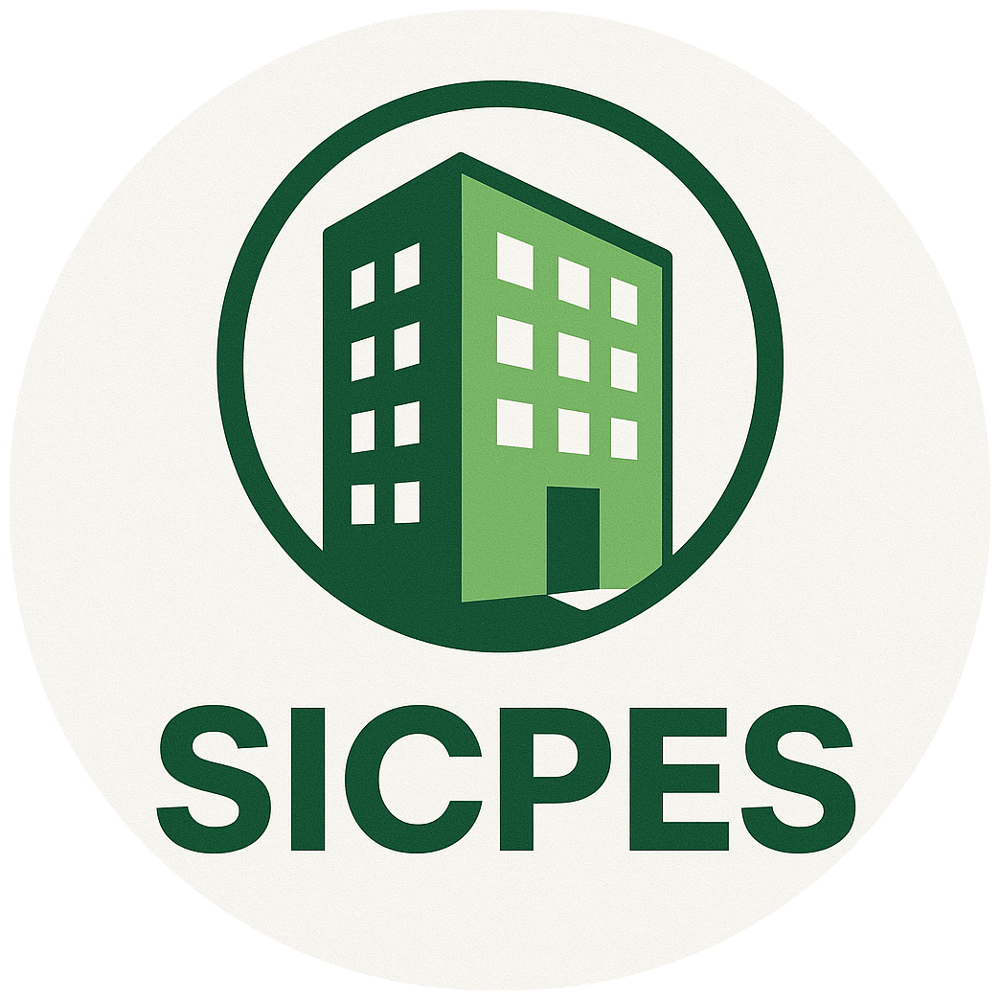
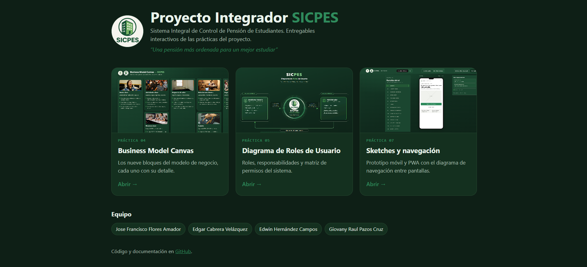
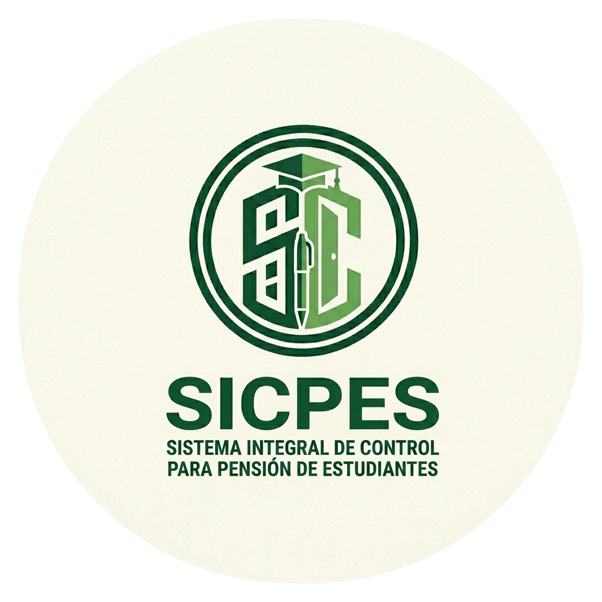
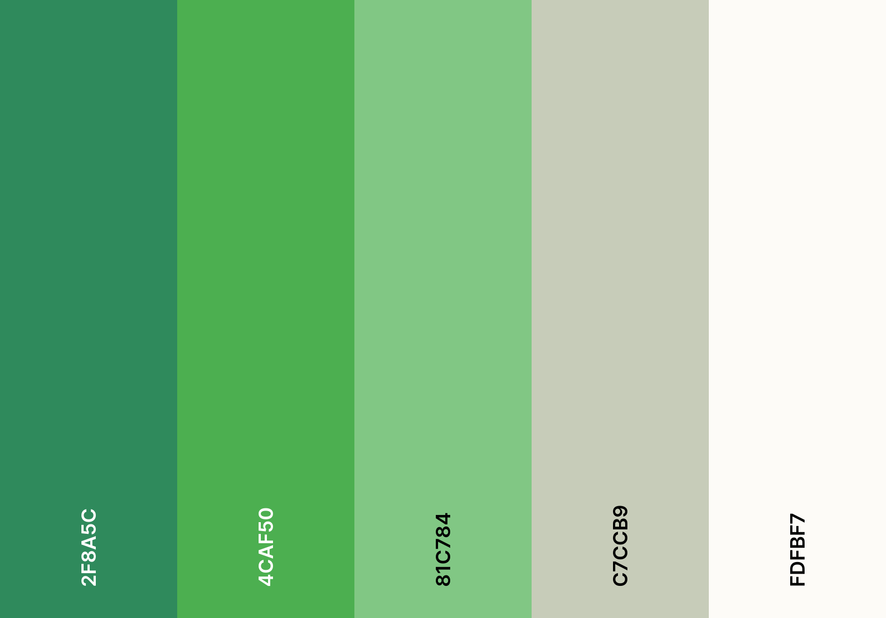
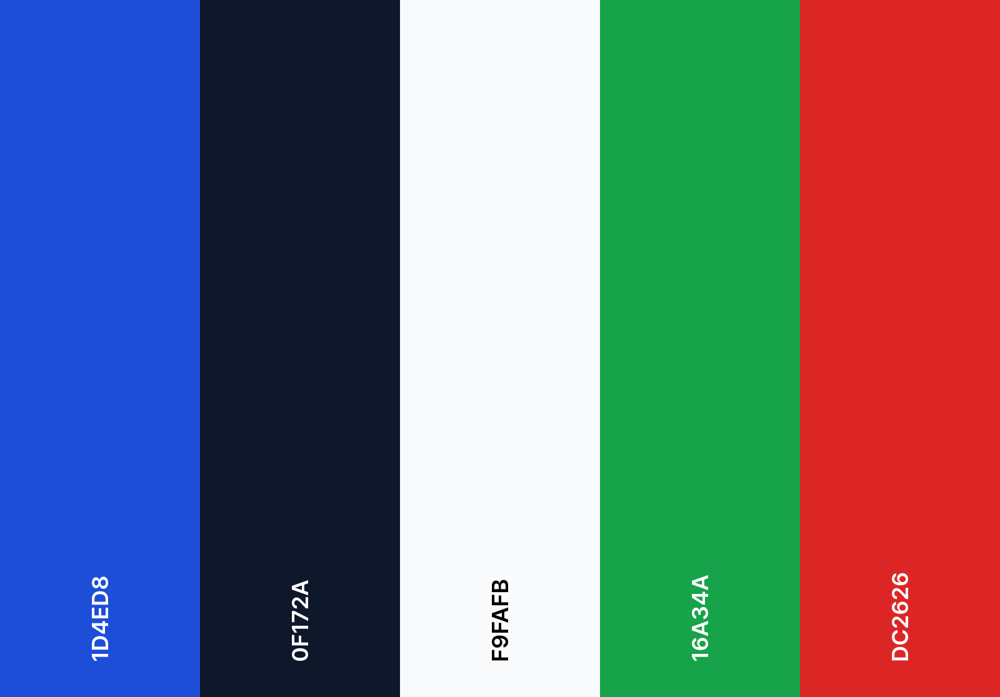
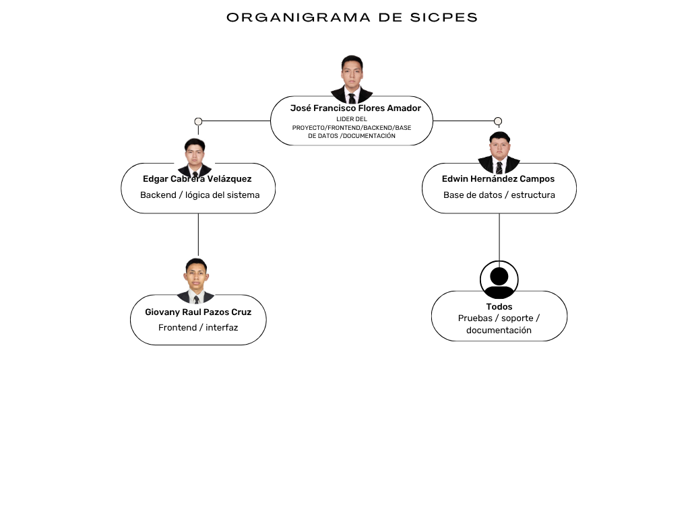
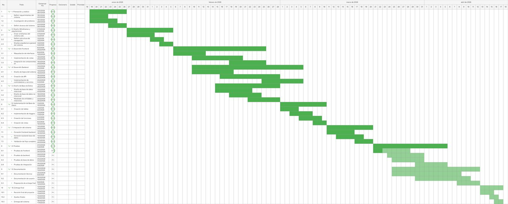

# 
SICPES

  <strong>Sistema Integral de Control de Pensión de Estudiantes</strong> 
  <em>"Conectando estudiantes con hogares seguros, digitalizando la gestión de pensiones."</em>

  

  
  
  
  
  
  

## Contenido

1. [Resumen Ejecutivo](#resumen-ejecutivo)
2. [Problemática vs Solución](#problemática-vs-solución)
3. [Alcance del sistema](#alcance-del-sistema)
4. [Tecnologías](#tecnologías)
5. [Web services y APIs externas](#web-services-y-apis-externas)
6. [Diagramas del Proyecto / Modelos](#diagramas-del-proyecto--modelos)
7. [Ver en línea (GitHub Pages)](#ver-en-línea-github-pages)
8. [Identidad Visual](#identidad-visual)
9. [Gestión del Proyecto](#gestión-del-proyecto)
10. [Nuestro Equipo](#nuestro-equipo)
11. [Docente](#docente)

## Resumen Ejecutivo

**¿Qué es SICPES?** SICPES (Sistema Integral de Control de Pensión de Estudiantes) es una plataforma web y móvil (PWA) que digitaliza la forma en que los estudiantes buscan, reservan y pagan un lugar en una pensión o casa de hospedaje, y la forma en que los responsables de esos inmuebles los administran.

**¿Para quién es?** Para dos grupos principales:
- **Estudiantes** (en especial foráneos) que necesitan encontrar un alojamiento seguro y cercano a su institución, solicitar un cuarto, pagar y dar seguimiento a su estancia.
- **Administradores de pensiones** que hoy controlan cuartos, pagos y adeudos de forma manual y necesitan una herramienta centralizada.

**Objetivo general:** conectar a estudiantes con espacios seguros y accesibles, y darle a los administradores una herramienta eficiente para controlar sus inmuebles, reservaciones, pagos y adeudos.

**Objetivos específicos:**
- Permitir al estudiante registrarse, consultar habitaciones disponibles y solicitar una reservación en línea.
- Dar al administrador un panel para asignar cuartos, validar pagos y consultar adeudos.
- Llevar un historial confiable de pagos y estancias, evitando errores y empalmes de reservaciones.
- Recoger la opinión del estudiante sobre el servicio (calificación de 1 a 5 y comentarios) para mejorar la operación.

### Por qué SICPES

| Beneficio | ¿Qué significa en la práctica? |
| :--- | :--- |
| **Automatización** | La disponibilidad de cuartos se controla de forma centralizada. Ya no hay que preguntar de forma manual si hay lugar ni llevar el conteo en papel. |
| **Seguridad** | Los usuarios inician sesión con una cuenta verificada por correo, y cada rol (estudiante o administrador) solo accede a lo que le corresponde. |
| **Finanzas claras** | Cada pago queda registrado y se compara con lo que se debe, de modo que estudiantes y administradores ven el mismo estado de cuenta y los adeudos. |
| **UX intuitiva** | Pantallas sencillas y paneles pensados para usarse desde el celular o la computadora sin capacitación previa. |

## Problemática vs Solución

Hoy, encontrar y administrar una pensión estudiantil depende de procesos informales: recomendaciones de boca en boca, mensajes sueltos y libretas de papel. Esto genera desorden para el estudiante y errores para quien administra.

| El Problema | ¿Por qué es un problema? | La Solución (SICPES) |
| :--- | :--- | :--- |
| Procesos informales y desorganizados en la búsqueda de pensión. | El estudiante no sabe qué hay disponible, cuánto cuesta ni qué reglas tiene cada lugar, y pierde tiempo comparando. | Plataforma intuitiva para visualizar disponibilidad y solicitar reservaciones desde un solo lugar. |
| Administración manual en libretas propensa a errores y pérdida de datos. | Una libreta se pierde, se daña o se llena de tachaduras; los cobros y fechas se pueden registrar mal. | Administrador digital que estandariza cobros y automatiza registros, con historial consultable. |
| Dificultad para validar pagos y empalme de reservaciones. | Puede asignarse el mismo cuarto a dos personas o darse por pagado algo que no lo está. | Sistema de validación en tiempo real y dashboards administrativos claros, con revisión del administrador antes de confirmar. |

## Alcance del sistema

### Módulos

| Módulo | ¿Qué hace? |
| :--- | :--- |
| **Cuenta y acceso** | Registro, verificación de correo, inicio de sesión y recuperación de contraseña. |
| **Cuartos y reservas** | Consulta de habitaciones, detalle de cada una, solicitud de reservación y seguimiento del estado de la petición. Para el administrador: revisar solicitudes y asignar habitación. |
| **Pagos** | Registro de pagos, consulta del estado de cuenta, validación de pagos pendientes y control de adeudos. |
| **Evaluación del servicio** | El estudiante califica su estancia (1 a 5) y deja comentarios; la administración consulta los resultados. |

### Roles de usuario

| Rol | Tipo | Responsabilidad principal |
| :--- | :--- | :--- |
| **Estudiante / Usuario** | Externo, actor principal | Registra su cuenta, pide un cuarto, realiza pagos y evalúa el servicio. |
| **Administrador** | Interno, actor secundario | Asigna cuartos, valida pagos, revisa adeudos y consulta resultados de las evaluaciones. |
| **Sistema SICPES** | Actor de sistema | Autentica, valida datos, registra reservaciones y pagos, y protege la información. |
| **Propietario / Dueño de la pensión** *(propuesta por validar)* | Interno | Agrega y mantiene la información de su casa o pensión (habitaciones, cupos, precios y reglas) y consulta adeudos y reportes. |

> El detalle completo de cada rol, con lo que puede y no puede hacer, está en el [Diagrama de Roles de Usuario](RolesDeUsuario/README.md).

## Tecnologías

| Capa | Herramientas | ¿Para qué se usa en SICPES? |
| :--- | :--- | :--- |
| **Frontend** | React, TypeScript, TailwindCSS    | **React** construye la interfaz por pantallas reutilizables; **TypeScript** añade tipos para detectar errores antes de ejecutar; **TailwindCSS** da estilos consistentes y diseño adaptable a celular y escritorio. |
| **Backend** | Node.js, Express, FastAPI (Python)    | **Node.js + Express** exponen la API REST con la lógica de negocio (cuentas, reservas, pagos) y la autenticación, y manejan **WebSockets** para la comunicación en tiempo real; **FastAPI** aporta servicios en Python con documentación automática de sus endpoints. |
| **Bases de Datos** | MySQL, MongoDB   | **MySQL** guarda la información estructurada: usuarios, habitaciones, reservas, pagos y adeudos. **MongoDB** se contempla para datos más flexibles que no encajan en tablas. |
| **Infraestructura** | Docker, Render, TiDB Serverless   | **Docker** empaqueta frontend, backend y API en contenedores; **Render** los despliega con HTTPS automático; **TiDB Serverless** aloja la base de datos MySQL con conexión cifrada. |
| **Documentación** | Swagger/OpenAPI, Markdown  | **Swagger/OpenAPI** describe cada endpoint de la API para probarlo y entenderlo; **Markdown** documenta el proyecto en este repositorio. |

## Web services y APIs externas

SICPES se apoya en servicios de terceros para capacidades que no conviene construir desde cero. Cada uno se muestra en el [Diagrama de Arquitectura](DiagramaDeArquitectura/README.md), con quién lo llama.

| Servicio | ¿Para qué se usa en SICPES? | Lo llama |
| :--- | :--- | :--- |
| **Geolocation API (HTML5)** | Obtiene la ubicación del dispositivo, solo con consentimiento del usuario. | Web |
| **Google Maps Embed** | Muestra la ubicación de la pensión en un mapa interactivo. | Web |
| **Mailtrap API** | Envía correos transaccionales: confirmación de cuenta y código de verificación en dos pasos por correo. | Backend |
| **Twilio API** | Servicio adicional para enviar mensajes y notificaciones por WhatsApp. | Backend |
| **PDFmonkey API** | Genera contratos de arrendamiento, recibos y reportes en PDF. | Backend |
| **OSRM API** | Calcula la ruta a pie y la distancia exacta hasta la pensión. | API complementaria |

## Diagramas del Proyecto / Modelos

| Entregable | Descripción | Documentación |
| :--- | :--- | :--- |
| **Business Model Canvas** | Los nueve bloques del modelo de negocio. | [Ver en línea](https://jffa25.github.io/SICPES_INTEGRADORA/ModeloCanvas/index.html) |
| **Diagrama de Roles de Usuario** | Roles, responsabilidades y matriz de permisos. | [README](RolesDeUsuario/README.md) · [Ver en línea](https://jffa25.github.io/SICPES_INTEGRADORA/RolesDeUsuario/diagrama-roles-usuario-sicpes.html) |
| **Sketches y navegación** | Prototipo móvil y PWA con el diagrama de navegación entre pantallas. | [Ver en línea](https://jffa25.github.io/SICPES_INTEGRADORA/Sketches/index.html) |
| **Diagrama de Arquitectura** | Capas, tecnologías, bases de datos, servicios externos y despliegue, de forma interactiva. | [README](DiagramaDeArquitectura/README.md) · [Ver en línea](https://jffa25.github.io/SICPES_INTEGRADORA/DiagramaDeArquitectura/arquitectura.html) |

### Diagrama de Arquitectura

SICPES sigue una **arquitectura cliente-servidor en capas**: clientes (Web React, y a futuro app Flutter y PWA) que consumen por HTTPS (REST / JSON) un Backend en Node.js y una API en FastAPI; ambos guardan los datos en MySQL (TiDB Serverless) y MongoDB, e integran seis servicios externos. Todo se despliega con Docker en Render.

  

El diagrama es interactivo: al hacer clic en cada componente se abre su detalle, hay flujos animados (registro, búsqueda de pensión y generación de contrato) y se distingue lo existente de lo planeado. Más información en el [README del diagrama](DiagramaDeArquitectura/README.md).

# SICPES - Panel de Navegacion

  

### Ver en línea (GitHub Pages)

- [Página principal del proyecto](https://jffa25.github.io/SICPES_INTEGRADORA/index.html)
- [Práctica 04 · Business Model Canvas](https://jffa25.github.io/SICPES_INTEGRADORA/ModeloCanvas/index.html)
- [Práctica 05 · Diagrama de Roles de Usuario](https://jffa25.github.io/SICPES_INTEGRADORA/RolesDeUsuario/diagrama-roles-usuario-sicpes.html)
- [Práctica 07 · Sketches y navegación](https://jffa25.github.io/SICPES_INTEGRADORA/Sketches/index.html)
- [Diagrama de Arquitectura](https://jffa25.github.io/SICPES_INTEGRADORA/DiagramaDeArquitectura/arquitectura.html)

## Identidad Visual

La identidad visual da coherencia a todo el proyecto: los mismos logos y colores se usan en el README, el Canvas, el diagrama de roles y los sketches.

### Logos del Proyecto

- **Logo de la empresa:** monograma "SC" con birrete y pluma, que representa el vínculo entre lo académico y el control del sistema.
- **Logo del producto (app):** un edificio dentro de un círculo, que representa la pensión o residencia que se gestiona.

  
  

### Paleta de Colores

Se eligieron tonos verdes porque transmiten confianza, calma y hogar, y hacen que la interfaz se sienta segura para un sistema que maneja pagos y datos personales. Los neutros dan descanso visual y mantienen buen contraste en el texto.

| Color | Código | Uso |
| :--- | :--- | :--- |
| Verde bosque | `#2F8A5C` | Color primario oscuro: títulos, bordes y elementos de énfasis. |
| Verde | `#4CAF50` | Acciones principales y botones. |
| Verde claro | `#81C784` | Acentos y estados activos. |
| Salvia | `#C7CCB9` | Textos secundarios y líneas suaves. |
| Crema | `#FDFBF7` | Fondos claros y texto sobre fondos oscuros. |

  

  

## Gestión del Proyecto

### Estructura Organizacional

El organigrama muestra cómo se reparte el trabajo en el equipo: la líder de proyecto coordina, y cada integrante se encarga de un área (backend, base de datos, frontend), mientras que las pruebas, el soporte y la documentación son responsabilidad de todo el equipo.

### Cronograma (Gantt)

El diagrama de Gantt organiza las actividades del proyecto en el tiempo: qué tareas hay, cuánto duran, en qué orden se hacen y cuáles dependen de otras. Sirve para dar seguimiento al avance y detectar retrasos.

## Nuestro Equipo

| Desarrollador | Rol | Responsabilidad | GitHub |
| :--- | :--- | :--- | :--- |
| **Jose Francisco Flores Amador** | Líder de Proyecto / Fullstack / Documentación | Coordina al equipo, desarrolla frontend y backend y mantiene la documentación. | [@JFFA25](https://github.com/JFFA25) |
| **Edgar Cabrera Velázquez** | Backend / Lógica del sistema | Construye la API y las reglas de negocio (cuentas, reservas, pagos). | [@Edgar-Cbr](https://github.com/Edgar-Cbr) |
| **Edwin Hernández Campos** | Base de datos / Estructura | Diseña y mantiene las tablas y la estructura de datos. | [@Edwinhdzcm](https://github.com/Edwinhdzcm) |
| **Giovany Raul Pazos Cruz** | Frontend / Interfaz | Diseña e implementa las pantallas y la experiencia de usuario. | [@giova0412](https://github.com/giova0412) |

## Docente

| Docente | Rol | GitHub |
| :--- | :--- | :--- |
| **M.T.I Marco Antonio R.** | Asesor / Evaluador del proyecto | [@MTI-MarcoRH](https://github.com/MTI-MarcoRHb) |