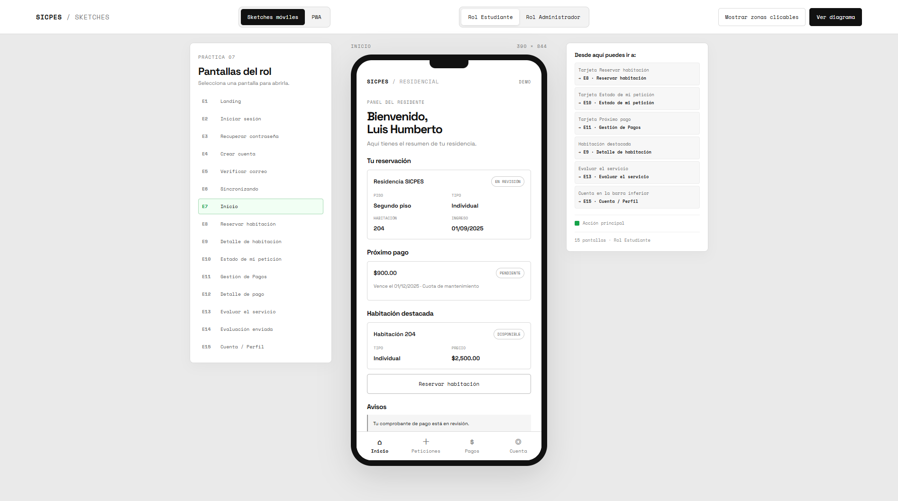
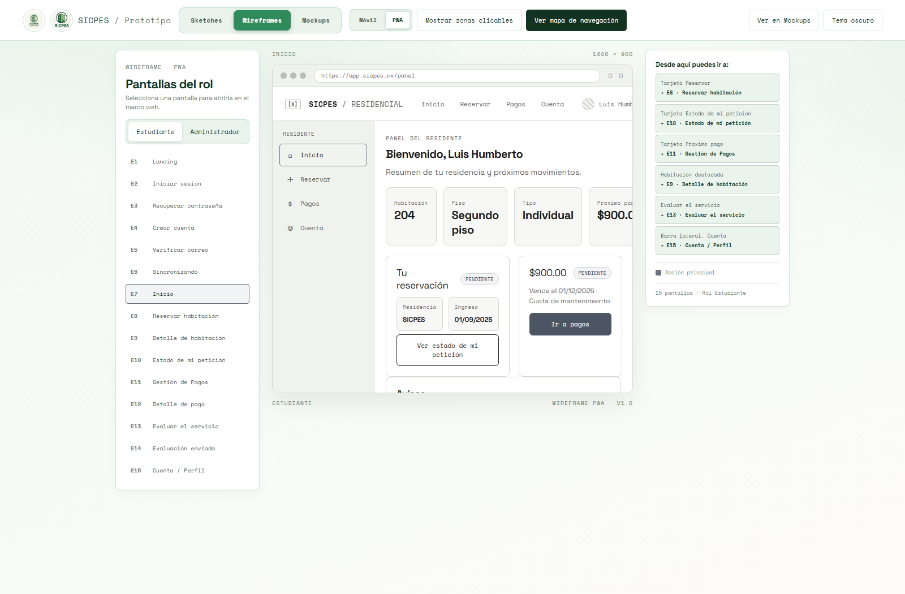
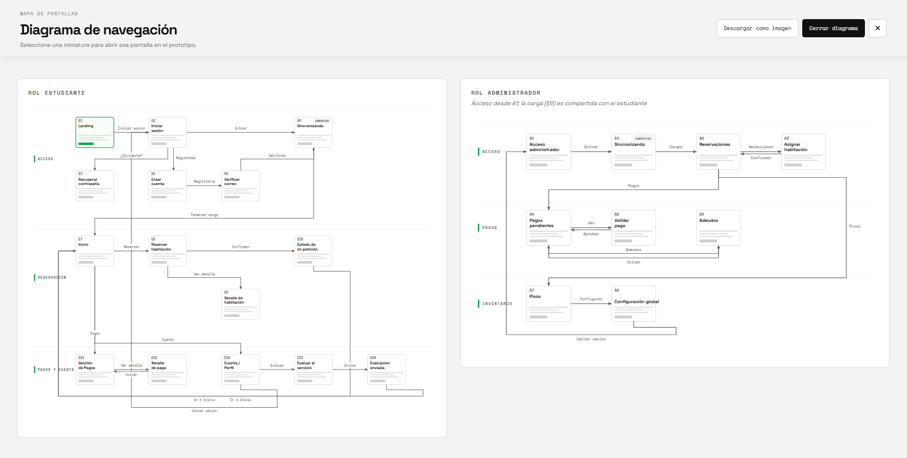

# SICPES · Sketches de navegación

Prototipo interactivo de sketches en HTML, CSS y JavaScript puros para la Práctica 07. Presenta los recorridos principales de estudiantes y administración en un marco móvil, un panel de pantallas y destinos interactivo, datos de ejemplo en español y un diagrama SVG seleccionable que puede descargarse como PNG.

## Ver en línea

**[Sketches de SICPES](https://jffa25.github.io/SICPES_INTEGRADORA/Sketches/index.html)**
 

## Visualización

### Móvil

### PWA

## Diagrama de Navegación

## Cómo abrirlo

- **En línea:** entra al enlace de GitHub Pages de arriba, sin instalar nada.
- **En local:** abre `index.html` en un navegador moderno. No requiere instalación ni compilación.

Google Fonts se usa como mejora tipográfica; sin conexión, la página conserva fuentes de respaldo.

## Pantallas (23 en total)

**Estudiante (15):** Landing, Iniciar sesión (E2), Crear cuenta (E3), Verificar correo (E4), Recuperar contraseña (E5), Carga compartida (E6), Inicio, Reservar habitación, Detalle de habitación, Estado de mi petición, Gestión de pagos, Detalle de pago, Evaluar el servicio, Evaluación enviada y Cuenta / Perfil.

**Administrador (8):** Login admin, Reservaciones, Asignar habitación, Pagos pendientes, Validar pago, Adeudos, Pisos y Configuración global.

## Mapa de navegación

| Origen | Acción | Destino |
|---|---|---|
| Landing | Explorar habitaciones | Detalle de habitación |
| Landing | Iniciar sesión | Iniciar sesión |
| Iniciar sesión | Entrar | Carga → Inicio |
| Iniciar sesión | ¿Olvidaste tu contraseña? | Recuperar contraseña |
| Iniciar sesión | Regístrate | Crear cuenta |
| Crear cuenta | Registrarse (aceptar términos) | Verificar correo |
| Verificar correo | Verificar código / Reenviar | Carga → Inicio |
| Recuperar contraseña | Enviar enlace | Iniciar sesión |
| Inicio | Tarjeta Tu reservación | Estado de mi petición |
| Inicio | Habitación destacada | Detalle de habitación |
| Inicio | Tarjeta Próximo pago / aviso | Gestión de pagos |
| Inicio | Evaluar el servicio | Evaluar el servicio |
| Reservar habitación | Ver detalle de la habitación | Detalle de habitación |
| Reservar habitación | Reservar | Estado de mi petición |
| Detalle de habitación | Solicitar esta habitación | Estado de mi petición |
| Estado de mi petición | Volver al inicio | Inicio |
| Gestión de pagos | Historial de pagos | Detalle de pago |
| Detalle de pago | Cargar comprobante / Volver | Comprobante cargado / Gestión de pagos |
| Cuenta / Perfil | Evaluar el servicio | Evaluar el servicio |
| Cuenta / Perfil | Cerrar sesión | Iniciar sesión |
| Evaluar el servicio | Enviar evaluación | Evaluación enviada |
| Evaluación enviada | Volver a Inicio | Inicio |
| Login admin | Entrar | Carga → Reservaciones |
| Reservaciones | Asignar | Asignar habitación |
| Asignar habitación | Asignar / Rechazar | Reservaciones |
| Pagos pendientes | Validar | Validar pago |
| Pagos pendientes | Ver adeudos | Adeudos |
| Validar pago | Aprobar / Rechazar | Pagos pendientes |
| Adeudos | Enviar recordatorio | Confirmación |
| Carga compartida | — | Inicio (estudiante) o Reservaciones (admin) |

> Nota: las pantallas **Adeudos** y **Recuperar contraseña** son alcance propuesto dentro del prototipo (no forman parte de las historias de usuario ya implementadas); se incluyen para completar el diagrama de navegación.