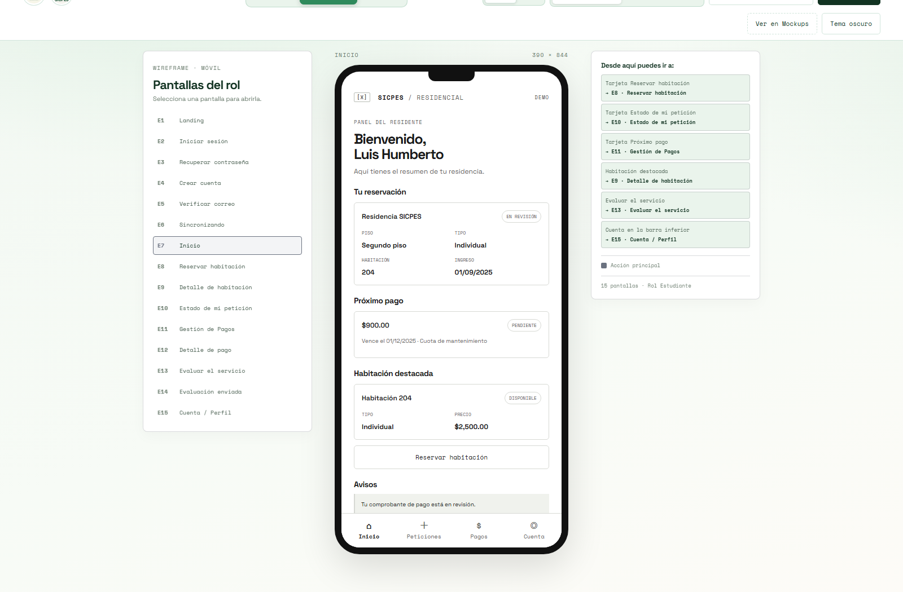
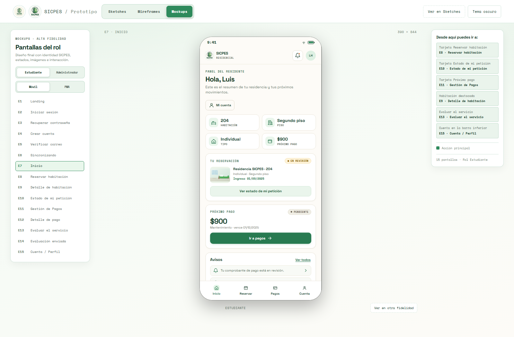
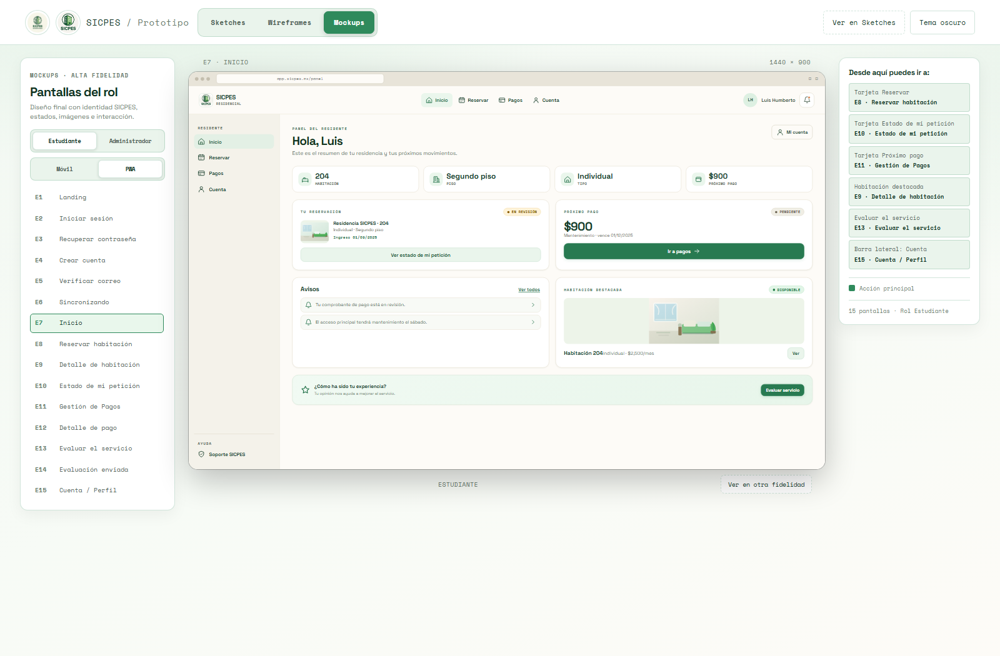

# SICPES · Sketches, Wireframes y Mockups

Prototipo interactivo en HTML, CSS y JavaScript puros para la Práctica 07. Organiza el diseño de las **23 pantallas** de SICPES en tres niveles de fidelidad, con recorridos para **estudiante** y **administración** en **móvil** y **PWA**.

- **Sketches:** bocetos a lápiz, sin color de marca, para explorar estructura y flujo.
- **Wireframes:** baja/media fidelidad en gris, con marco móvil de 390 × 844 y ventana PWA de 1440 × 900.
- **Mockups:** diseño final de alta fidelidad con identidad SICPES, estados, imágenes e interacción.

## Ver en línea

**[Sketches, Wireframes y Mockups de SICPES](https://jffa25.github.io/SICPES_INTEGRADORA/Sketches/index.html)**

[](https://jffa25.github.io/SICPES_INTEGRADORA/Sketches/index.html)

## Visualización

### Sketches


### Wireframes móvil



### Wireframes PWA


### Mockups móvil



### Mockups PWA



## Cómo se organiza

| Sección | Qué muestra | Controles propios | Ruta directa |
|---|---|---|---|
| **Sketches** | 23 láminas a lápiz sobre papel, con notas y cajas | Rol, plataforma, modal, flechas del teclado y descarga PNG | `#sketches` / `#sketches/pwa` |
| **Wireframes** | Pantallas en gris, sin logotipos ni color de marca | Rol, plataforma, diagrama móvil y mapa PWA | `#wireframes` / `#wireframes/pwa` |
| **Mockups** | Diseño final con paleta, logotipos, fotos, estados y formularios | Rol, plataforma, navegación real y destinos | `#mockups` / `#mockups/pwa` |

La barra superior mantiene siempre visible el selector de fidelidad. El botón **Ver en otra fidelidad** recorre Sketches → Wireframes → Mockups conservando la pantalla, el rol y la plataforma. También puedes abrir una sección directamente con las rutas indicadas arriba.

Cada sección conserva su propio estado. Los cambios de tema claro/oscuro afectan al espacio de trabajo, mientras que el lienzo del mockup mantiene el fondo crema de la marca para que el diseño final no cambie de aspecto.

## Cómo abrirlo

- **En línea:** entra al enlace de GitHub Pages, sin instalar nada.
- **En local:** abre `index.html` en un navegador moderno. No requiere instalación ni compilación.

Google Fonts se usa como mejora tipográfica; sin conexión, la página conserva fuentes de respaldo.

## Pantallas (23 en total)

**Estudiante (15):** E1 Landing · E2 Iniciar sesión · E3 Recuperar contraseña · E4 Crear cuenta · E5 Verificar correo · E6 Carga compartida · E7 Inicio · E8 Reservar habitación · E9 Detalle de habitación · E10 Estado de mi petición · E11 Gestión de pagos · E12 Detalle de pago · E13 Evaluar el servicio · E14 Evaluación enviada · E15 Cuenta / Perfil.

**Administrador (8):** A1 Login admin · A2 Reservaciones · A3 Asignar habitación · A4 Pagos pendientes · A5 Validar pago · A6 Adeudos · A7 Pisos · A8 Configuración global.

## Funciones principales

- **Tres fidelidades conectadas:** la misma pantalla, rol y plataforma se conservan al saltar entre secciones.
- **Dos plataformas:** marco móvil de 390 × 844 y ventana PWA de 1440 × 900, con escalado automático al espacio disponible.
- **Sketches:** modal ampliado, navegación con ←/→/Esc, descarga individual o de todas las láminas en PNG.
- **Wireframes móvil:** diagrama de navegación descargable como PNG y zonas clicables.
- **Wireframes PWA:** mapa de navegación de escritorio con miniaturas seleccionables.
- **Mockups:** navegación entre pantallas, destinos sugeridos, selector de rol y plataforma, filtros, calificación con estrellas, formularios, carga de comprobantes, pisos y ajustes.
- **Tema claro/oscuro** persistente y diseño adaptable a distintos tamaños de ventana.

## Estructura de archivos

```text
Sketches/
├─ index.html          Estructura de las tres secciones
├─ data.js             Puente único a los datos de app.js y pwa.js
├─ fidelity.js         Selector de fidelidad, rutas y conservación de contexto
├─ sections.css        Barra superior y ajustes de las secciones
├─ wireframes.css      Tratamiento gris de los wireframes
├─ app.js              Wireframe móvil, datos y acciones
├─ pwa.js              Wireframe PWA, datos y acciones
├─ pencil-screens.js   Especificaciones de las láminas
├─ pencil.js           Render de sketches y descargas
├─ pencil.css
├─ mockups/
│  ├─ mockups.js       Render de alta fidelidad e interacción
│  └─ mockups.css      Sistema visual de los mockups
└─ README.md
```

## Mapa de navegación

| Origen | Acción | Destino |
|---|---|---|
| Landing | Explorar habitaciones | Detalle de habitación |
| Landing | Iniciar sesión | Iniciar sesión |
| Iniciar sesión | Entrar | Carga → Inicio |
| Iniciar sesión | ¿Olvidaste tu contraseña? | Recuperar contraseña |
| Iniciar sesión | Regístrate | Crear cuenta |
| Crear cuenta | Registrarse (aceptar términos) | Verificar correo |
| Verificar correo | Verificar código / Reenviar | Carga → Inicio |
| Recuperar contraseña | Enviar enlace | Iniciar sesión |
| Inicio | Tarjeta Tu reservación | Estado de mi petición |
| Inicio | Habitación destacada | Detalle de habitación |
| Inicio | Tarjeta Próximo pago / aviso | Gestión de pagos |
| Inicio | Evaluar el servicio | Evaluar el servicio |
| Reservar habitación | Ver detalle de la habitación | Detalle de habitación |
| Reservar habitación | Reservar | Estado de mi petición |
| Detalle de habitación | Solicitar esta habitación | Estado de mi petición |
| Estado de mi petición | Volver al inicio | Inicio |
| Gestión de pagos | Historial de pagos | Detalle de pago |
| Detalle de pago | Cargar comprobante / Volver | Comprobante cargado / Gestión de pagos |
| Cuenta / Perfil | Evaluar el servicio | Evaluar el servicio |
| Cuenta / Perfil | Cerrar sesión | Iniciar sesión |
| Evaluar el servicio | Enviar evaluación | Evaluación enviada |
| Evaluación enviada | Volver a Inicio | Inicio |
| Login admin | Entrar | Carga → Reservaciones |
| Reservaciones | Asignar | Asignar habitación |
| Asignar habitación | Asignar / Rechazar | Reservaciones |
| Pagos pendientes | Validar | Validar pago |
| Pagos pendientes | Ver adeudos | Adeudos |
| Validar pago | Aprobar / Rechazar | Pagos pendientes |
| Adeudos | Enviar recordatorio | Adeudos (aviso de envío) |
| Carga compartida | — | Inicio (estudiante) o Reservaciones (admin) |

> Nota: las pantallas **Adeudos** y **Recuperar contraseña** son alcance propuesto dentro del prototipo y se incluyen para completar el recorrido de navegación.
