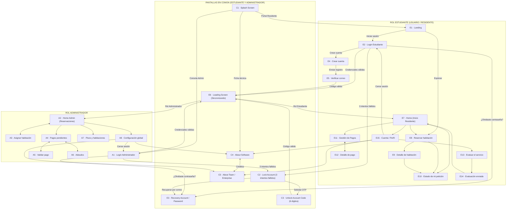

# Práctica 07 · Sketches de Baja Fidelidad, Estructura y Diagrama de Navegación — SICPES

> **Proyecto Integrador:** SICPES (*Sistema Integral de Control de Pensión de Estudiantes*)  
> **Institución:** Universidad Tecnológica de la Huasteca Hidalguense (UTHH)  
> **Carrera:** Ingeniería en Desarrollo y Gestión de Software  
> **Plataformas de destino:** Aplicación Web Progresiva (**PWA con React / Vite**) y Aplicación Móvil Multiplataforma (**Flutter / Dart**)  
> **Agente y entorno de prototipado:** **Archify** + Motor de trazos a lápiz **Rough.js** + Diagrama de navegación ortogonal interactivo

---

## 1. Descripción y Objetivo de la Práctica

El presente entregable documenta la **estructura de navegación** y el diseño de **28 pantallas únicas** (superando el mínimo de 20 sketches solicitados), elaboradas en tres niveles de fidelidad sincronizados (**Sketches a lápiz**, **Wireframes de media fidelidad** y **Mockups de alta fidelidad**) y en las dos plataformas tecnológicas seleccionadas para el Proyecto Integrador:

1. **Aplicación Móvil Multiplataforma (Flutter / Dart):** Lienzos verticales con barra de navegación inferior (`BottomNavigationBar`).
2. **Aplicación Web Progresiva (PWA React / Vite):** Lienzos de escritorio con marco de navegador, rutas URL y barra lateral (`Sidebar`).

### Cómo abrir el prototipo interactivo
1. Abre [`Sketches/index.html`](index.html) directamente en cualquier navegador moderno (Chrome, Edge o Firefox), o sírvelo con una extensión como *Live Server*.
2. En la barra superior elige la fidelidad: **`1 Sketches`** (bocetos a lápiz), **`2 Wireframes`** o **`3 Mockups`**.
3. En la subbarra elige el **Rol**:
   - **`Estudiante`** (20 pantallas: 13 exclusivas + 7 comunes)
   - **`Administrador`** (15 pantallas: 8 exclusivas + 7 comunes)
   - **`Comunes (Ambos)`** (Apartado dedicado a las 7 pantallas que comparten ambos roles)
4. Elige la **Plataforma**: **`Móvil`** (Flutter) o **`PWA`** (React/Vite).
5. Haz clic en **`Ver diagrama de navegación`** (o presiona la tecla `D`) para abrir el **diagrama interactivo de navegación** organizado en tres bloques: **Pantallas en Común**, **Rol Estudiante** y **Rol Administrador**.

---

## 2. Roles de Usuario, Permisos y Restricciones

| Rol de Usuario | Descripción y Responsabilidades | Módulos y Operaciones Autorizadas | Restricciones de Acceso |
| :--- | :--- | :--- | :--- |
| **Estudiante (Usuario / Residente)** | Estudiante universitario que busca alojamiento o ya reside en la pensión administrada por SICPES. | Explorar landing y catálogo público, registrarse y verificar correo con código OTP, iniciar/recuperar/desbloquear sesión, consultar su panel de inicio (`Home`), solicitar reservación de habitación, dar seguimiento al estado de su petición, consultar pagos pendientes, subir comprobantes PDF/imagen, evaluar la satisfacción del servicio (`HU-SIC-05`) y consultar su perfil, información del software y del equipo. | Sin acceso al panel administrativo (`A1–A8`), aprobación/rechazo de solicitudes de otros residentes, validación contable de pagos, cartera vencida global ni alta/baja de pisos o tarifas. |
| **Administrador (Arrendador / Coordinador)** | Personal autorizado encargado de administrar el inmueble, validar cobros y asignar espacios. | Iniciar/recuperar/desbloquear sesión administrativa, consultar tablero de reservaciones con métricas, asignar o rechazar solicitudes de habitación, supervisar pagos pendientes, aprobar o rechazar comprobantes bancarios, gestionar adeudos y enviar recordatorios de cobro, administrar inventario de pisos/habitaciones y configurar precios/notificaciones globales, además de consultar información del software y del equipo. | Acceso exclusivo mediante credenciales administrativas (`A1`). No realiza solicitudes de habitación ni responde encuestas de satisfacción de residentes. |

---

## 3. Apartado Especial: Pantallas en Común entre Estudiante (Usuario) y Administrador

Tanto en la interfaz interactiva (pestaña **`Comunes (Ambos)`** y el bloque **`Apartado · Pantallas en común (7)`** de la barra lateral izquierda y del diagrama de navegación) como en la arquitectura del sistema, existen **7 pantallas compartidas** que mantienen la **misma estructura visual y funcional** para ambos roles (`Estudiante` y `Administrador`) en **Flutter** y **PWA React/Vite**:

| Código | ID Interno | Nombre de Pantalla | Categoría Padlet | ¿Por qué es común en Administrador y Usuario? | Comportamiento según el Rol Activo |
| :---: | :--- | :--- | :--- | :--- | :--- |
| **`C1`** | `splash` | **Splash Screen** | Obligatoria (1/9) | Es el punto de arranque único al abrir la App Móvil Flutter o instalar/iniciar la PWA React/Vite. Muestra el logotipo oficial de SICPES, versión `v2.4.0` y eslogan institucional. | Permite dirigirse al flujo de **Estudiante (`E1` / `E2`)**, al acceso de **Administrador (`A1`)** o consultar **Acerca del software (`C4`)** y **Acerca del equipo (`C5`)**. |
| **`E6`** | `loading` | **Loading Screen (Sincronizando)** | Obligatoria (2/9) | Pantalla de transición y carga asíncrona que valida el token de sesión (JWT) y sincroniza los registros residenciales con el backend (`Node.js` / `FastAPI` + `TiDB`). | Al completar el `100%` de la barra de progreso, redirige automáticamente a **`E7 · Inicio`** si el rol es `Estudiante`, o a **`A2 · Reservaciones`** si el rol es `Administrador`. |
| **`E3`** | `forgotPassword` | **Recovery Account or Password** | Obligatoria (4/9) | Formulario unificado de recuperación de cuenta mediante correo electrónico (`Mailtrap API`) para cualquier usuario registrado en el sistema. | Envía las instrucciones de restablecimiento al correo ingresado y retorna al login correspondiente (**`E2`** para Estudiante o **`A1`** para Administrador) o enlaza a **`C3`**. |
| **`C2`** | `lockAccount` | **Lock Account (Cuenta bloqueada)** | Obligatoria (5/9) | Regla de seguridad transversal: tras **3 intentos fallidos consecutivos** de contraseña en `E2` (Estudiante) o `A1` (Administrador), la cuenta se bloquea temporalmente por `15:00 min`. | Muestra alerta de seguridad, contador de espera y botón directo para solicitar un código de verificación (**`C3`**) o recuperar contraseña (**`E3`**). |
| **`C3`** | `unlockAccount` | **Unlock Account Code** | Obligatoria (6/9) | Pantalla de validación de identidad mediante código OTP de **6 dígitos** enviado por correo/SMS (`Mailtrap` / `Twilio API`) para levantar el bloqueo de seguridad. | Al validar los 6 dígitos, reactiva la cuenta y dirige a la pantalla de carga compartida (**`E6`**) para ingresar al panel del rol correspondiente. |
| **`C4`** | `aboutSoftware` | **About Software (Acerca del software)** | Obligatoria (7/9) | Ficha técnica y presentación institucional del software SICPES: versión `2.4.0`, arquitectura híbrida (`PWA React/Vite`, `Flutter`, `Node.js`, `FastAPI`, `MySQL TiDB`, `MongoDB`) y módulos. | Accesible desde **`C1 · Splash`**, **`E1 · Landing`**, **`E15 · Perfil`** (Estudiante) y **`A8 · Configuración`** (Administrador). Conserva la navegación de retorno al rol activo. |
| **`C5`** | `aboutTeam` | **About Team / Enterprise (Acerca del equipo)** | Obligatoria (8/9) | Créditos del equipo desarrollador del Proyecto Integrador en la UTHH, roles técnicos, usuarios de GitHub y misión del proyecto. | Accesible desde **`C4 · Acerca del software`**, **`E15 · Perfil`** (Estudiante) y **`A8 · Configuración`** (Administrador), retornando al módulo de origen según el rol. |

---

## 4. Cumplimiento de las 9 Pantallas Obligatorias y 19 Pantallas de Funcionalidades (28 Totales)

### 4.1 Las 9 Pantallas Obligatorias de la Práctica
1. **Splash Screen:** `C1 · Splash Screen` (`splash`) — *Común*
2. **Loading Screen:** `E6 · Sincronizando / Pantalla de carga` (`loading`) — *Común*
3. **Login Screen:** `E2 · Iniciar sesión (Estudiante)` (`studentLogin`) y `A1 · Acceso administrador` (`adminLogin`)
4. **Recovery Account or Password:** `E3 · Recuperar contraseña` (`forgotPassword`) — *Común*
5. **Lock Account (bloqueo por exceso de intentos fallidos):** `C2 · Cuenta bloqueada` (`lockAccount`) — *Común*
6. **Unlock Account Code (desbloqueo mediante código de verificación):** `C3 · Código de desbloqueo` (`unlockAccount`) — *Común*
7. **About Software:** `C4 · Acerca del software` (`aboutSoftware`) — *Común*
8. **About Team / Enterprise:** `C5 · Acerca del equipo` (`aboutTeam`) — *Común*
9. **Home (pantalla principal del sistema):** `E7 · Inicio (Panel del residente)` (`home`) y `A2 · Reservaciones (Home administrativo)` (`reservations`)

### 4.2 Las 19 Pantallas Adicionales de Funcionalidades (Features por Rol)
- **Rol Estudiante (12 pantallas adicionales de features):** `E1 · Landing`, `E4 · Crear cuenta`, `E5 · Verificar correo`, `E8 · Reservar habitación`, `E9 · Detalle de habitación`, `E10 · Estado de mi petición`, `E11 · Gestión de Pagos`, `E12 · Detalle de pago`, `E13 · Evaluar el servicio`, `E14 · Evaluación enviada`, `E15 · Cuenta / Perfil` (+ `E2` y `E7` = 13 exclusivas de Estudiante).
- **Rol Administrador (6 pantallas adicionales de features):** `A3 · Asignar habitación`, `A4 · Pagos pendientes`, `A5 · Validar pago`, `A6 · Adeudos`, `A7 · Pisos y habitaciones`, `A8 · Configuración global` (+ `A1` y `A2` = 8 exclusivas de Administrador).

---

## 5. Documentación Individual de las 28 Pantallas (Sketches)

| Código | Nombre de Pantalla | Descripción Funcional | Plataforma | Rol Autorizado | Elementos Principales del Sketch | Acciones Disponibles | Pantallas Relacionadas | Requerimiento / HU |
| :---: | :--- | :--- | :---: | :---: | :--- | :--- | :---: | :---: |
| **`C1`** | **Splash Screen** (`splash`) | Pantalla de inicialización del sistema que presenta la identidad visual de SICPES, versión y accesos iniciales. | Ambas (Flutter y PWA) | **Común** (Estudiante y Admin) | Logotipo con trazo en X, chip de versión `v2.4.0`, título, eslogan y 4 botones de arranque. | Ir a Landing Estudiante, abrir Login Admin, ver Acerca del software o Acerca del equipo. | `E1`, `A1`, `C4`, `C5` | `RF-GEN-01` Inicialización |
| **`C2`** | **Cuenta bloqueada** (`lockAccount`) | Alerta de seguridad mostrada al exceder 3 intentos fallidos de inicio de sesión. | Ambas (Flutter y PWA) | **Común** (Estudiante y Admin) | Icono de candado/alerta, chip de `3 INTENTOS FALLIDOS`, tarjeta con temporizador `15:00 min` y botones de desbloqueo. | Solicitar código OTP de desbloqueo, ir a recuperar contraseña o volver al login. | `E2`, `A1`, `C3`, `E3` | `RF-SEG-01` Bloqueo por intentos |
| **`C3`** | **Código de desbloqueo** (`unlockAccount`) | Verificación mediante código numérico de 6 dígitos para desbloquear una cuenta restringida. | Ambas (Flutter y PWA) | **Común** (Estudiante y Admin) | Encabezado de verificación, 6 casillas OTP de un dígito, botón principal achurado y enlace de reenvío. | Validar código de 6 dígitos, reenviar código OTP o regresar al login. | `C2`, `E6`, `E2`, `A1` | `RF-SEG-02` Desbloqueo OTP |
| **`C4`** | **Acerca del software** (`aboutSoftware`) | Ficha técnica del sistema SICPES, versión, arquitectura tecnológica y módulos integrados. | Ambas (Flutter y PWA) | **Común** (Estudiante y Admin) | Tarjeta de versión `2.4.0`, cuadrícula de 4 tarjetas de stack (`React/Vite`, `Flutter`, `Node/FastAPI`, `TiDB/Mongo`), lista de módulos y botones. | Consultar Acerca del equipo (`C5`) o volver al módulo de cuenta/configuración. | `C5`, `E15`, `A8`, `C1`, `E1` | `RF-GEN-02` Presentación software |
| **`C5`** | **Acerca del equipo** (`aboutTeam`) | Presentación de los integrantes del equipo desarrollador y créditos institucionales UTHH. | Ambas (Flutter y PWA) | **Común** (Estudiante y Admin) | 4 tarjetas de integrantes con avatar en X, nombre, rol técnico y usuario GitHub (`@JFFA25`, `@Edgar-Cbr`, `@Edwinhdzcm`, `@giova0412`). | Volver a Acerca del software (`C4`) o regresar al panel del rol activo (`E15` / `A8`). | `C4`, `E15`, `A8`, `C1`, `E1` | `RF-GEN-03` Créditos del equipo |
| **`E1`** | **Landing** (`landing`) | Página pública de bienvenida con propuesta de valor, habitaciones destacadas y llamadas a la acción. | Ambas (Flutter y PWA) | **Estudiante** (Público) | Encabezado, imagen hero con X, botones `Explorar habitaciones` e `Iniciar sesión`, tarjetas de ventajas y habitación destacada. | Explorar catálogo, iniciar sesión, ver detalle de habitación o consultar `C4` y `C5`. | `C1`, `E2`, `E8`, `E9`, `C4`, `C5` | `RF-EST-01` Portal público |
| **`E2`** | **Iniciar sesión** (`studentLogin`) | Autenticación de estudiantes mediante correo institucional/personal, contraseña o redes sociales. | Ambas (Flutter y PWA) | **Estudiante** | Campos de correo y contraseña, botón `Entrar`, enlace `¿Olvidaste tu contraseña?`, botones OAuth y enlace a registro. | Autenticarse (`E6`), recuperar contraseña (`E3`), simular bloqueo (`C2`) o registrarse (`E4`). | `E1`, `E6`, `E3`, `C2`, `E4` | `HU-SIC-01` Autenticación |
| **`E3`** | **Recuperar contraseña** (`forgotPassword`) | Solicitud de enlace o código de recuperación de acceso por correo electrónico. | Ambas (Flutter y PWA) | **Común** (Estudiante y Admin) | Campo de correo registrado, nota de seguridad, botón `Enviar enlace` y botón `Ya tengo código de desbloqueo`. | Enviar enlace de restablecimiento, abrir desbloqueo por código (`C3`) o volver al login (`E2`/`A1`). | `E2`, `A1`, `C2`, `C3` | `RF-SEG-03` Recuperación |
| **`E4`** | **Crear cuenta** (`register`) | Registro de nuevos estudiantes con datos personales, correo y contraseña. | Ambas (Flutter y PWA) | **Estudiante** | 4 campos de formulario (nombre, correo, contraseña, confirmación), casilla de términos y botón `Registrarse`. | Enviar registro para verificar correo (`E5`) o volver a iniciar sesión (`E2`). | `E2`, `E5` | `HU-SIC-01` Registro |
| **`E5`** | **Verificar correo** (`verifyEmail`) | Confirmación de cuenta nueva mediante código OTP de 6 dígitos enviado por correo. | Ambas (Flutter y PWA) | **Estudiante** | 6 cajas de dígitos OTP, botón `Verificar código` y acción `Reenviar código`. | Confirmar código y pasar a pantalla de carga (`E6`) o reenviar código. | `E4`, `E6` | `RF-SEG-04` Verificación email |
| **`E6`** | **Sincronizando / Carga** (`loading`) | Pantalla de carga compartida que sincroniza el perfil y estado residencial tras autenticarse. | Ambas (Flutter y PWA) | **Común** (Estudiante y Admin) | Logotipo central, título `Preparando tu espacio`, barra de progreso animada (`0%–100%`) e indicador de estado. | Transición automática a `E7 · Inicio` (Estudiante) o `A2 · Reservaciones` (Admin). | `E2`, `E5`, `C3`, `A1`, `E7`, `A2` | `RNF-UI-01` Feedback de carga |
| **`E7`** | **Inicio (Home Residente)** (`home`) | Pantalla principal del estudiante con resumen de su reservación, próximo pago, habitación destacada y avisos. | Ambas (Flutter y PWA) | **Estudiante** | Tarjeta de reservación actual, tarjeta de próximo pago, habitación destacada, lista de avisos y barra de navegación. | Ir a estado de petición (`E10`), pagos (`E11`), reservar (`E8`), detalle (`E9`), evaluar (`E13`) o perfil (`E15`). | `E6`, `E8`, `E9`, `E10`, `E11`, `E13`, `E15` | `HU-SIC-02` Dashboard residente |
| **`E8`** | **Reservar habitación** (`reserve`) | Formulario para configurar y solicitar una habitación por fecha de ingreso, modalidad, piso y número. | Ambas (Flutter y PWA) | **Estudiante** | Selector de fecha, chips `Individual`/`Compartida`, selectores de piso y habitación, recuadro de precio mensual y botón `Reservar`. | Ver detalle de habitación (`E9`) o confirmar solicitud (`E10`). | `E7`, `E9`, `E10` | `HU-SIC-02` Solicitud de reserva |
| **`E9`** | **Detalle de habitación** (`roomDetail`) | Ficha informativa de una habitación con galería, piso, tarifa mensual, disponibilidad y servicios incluidos. | Ambas (Flutter y PWA) | **Estudiante** | Imagen de habitación con X, cuadrícula de datos (tipo, piso, precio, estado), lista de servicios y botón `Solicitar`. | Solicitar la habitación (`E10`) o volver al formulario de reserva (`E8`). | `E1`, `E7`, `E8`, `E10` | `HU-SIC-02` Catálogo |
| **`E10`** | **Estado de mi petición** (`requestStatus`) | Seguimiento en línea de tiempo del estado de la solicitud de reservación (`Pendiente`, `En revisión`, `Aceptada/Rechazada`). | Ambas (Flutter y PWA) | **Estudiante** | Componente de línea de tiempo vertical de 3 pasos, tarjeta de habitación por confirmar y botón de retorno. | Volver al inicio (`E7`) o explorar más habitaciones (`E8`). | `E7`, `E8`, `E9` | `HU-SIC-03` Seguimiento |
| **`E11`** | **Gestión de Pagos** (`payments`) | Estado de cuenta del estudiante con cuota pendiente, carga de comprobante e historial de pagos. | Ambas (Flutter y PWA) | **Estudiante** | Tarjeta de próximo pago con botón `Solicitar pago`, zona `dropzone` para subir comprobante y lista de historial. | Solicitar pago, adjuntar archivo PDF/imagen o abrir el detalle de un pago (`E12`). | `E7`, `E12` | `HU-SIC-04` Pagos residente |
| **`E12`** | **Detalle de pago** (`paymentDetail`) | Desglose de un pago mensual específico con estado de validación, carga de voucher e historial previo. | Ambas (Flutter y PWA) | **Estudiante** | Tarjeta con monto y estatus (`EN REVISIÓN`), datos del mes/concepto, selector de comprobante y botón `Volver`. | Subir comprobante actualizado o regresar a Gestión de Pagos (`E11`). | `E11` | `HU-SIC-04` Comprobantes |
| **`E13`** | **Evaluar el servicio** (`rateService`) | Encuesta de satisfacción residencial con escala del 1 al 5 y comentario abierto (`HU-SIC-05`). | Ambas (Flutter y PWA) | **Estudiante** | Escala interactiva de 5 estrellas/botones (`1–5`), etiqueta descriptiva, área de texto (`0/500`) y botón `Enviar`. | Seleccionar calificación, redactar comentario y enviar evaluación (`E14`). | `E7`, `E15`, `E14` | `HU-SIC-05` Satisfacción |
| **`E14`** | **Evaluación enviada** (`rateConfirm`) | Pantalla de confirmación y agradecimiento tras registrar la evaluación del servicio. | Ambas (Flutter y PWA) | **Estudiante** | Recuadro ilustrativo `GRACIAS`, mensaje de confirmación y botón `Volver a Inicio`. | Retornar al panel principal del estudiante (`E7`). | `E13`, `E7` | `HU-SIC-05` Confirmación |
| **`E15`** | **Cuenta / Perfil** (`profile`) | Datos personales y académicos del estudiante, habitación asignada y enlaces de información/cierre de sesión. | Ambas (Flutter y PWA) | **Estudiante** | Avatar circular con X, tarjeta con nombre, correo, rol y habitación, botones a `C4`, `C5`, `E13` y `Cerrar sesión`. | Evaluar servicio (`E13`), consultar Acerca del software (`C4`), Acerca del equipo (`C5`) o cerrar sesión (`E2`). | `E7`, `E13`, `C4`, `C5`, `E2` | `RF-EST-05` Perfil de usuario |
| **`A1`** | **Acceso administrador** (`adminLogin`) | Inicio de sesión exclusivo para personal administrativo de la pensión. | Ambas (Flutter y PWA) | **Administrador** | Campos de correo administrativo y contraseña, botón `Entrar`, enlace de recuperación y simulación de bloqueo. | Iniciar sesión (`E6` → `A2`), recuperar contraseña (`E3`) o activar bloqueo por 3 intentos (`C2`). | `C1`, `E6`, `A2`, `E3`, `C2` | `RF-ADM-01` Login admin |
| **`A2`** | **Reservaciones (Home Admin)** (`reservations`) | Panel principal del administrador con indicadores de solicitudes y listado filtrable por estado. | Ambas (Flutter y PWA) | **Administrador** | Cuadrícula de 4 KPIs (`Total`, `Pendientes`, `Aceptadas`, `Rechazadas`), pestañas de filtro y tarjetas/tabla de solicitudes. | Filtrar por estado y seleccionar una solicitud para asignar habitación (`A3`). | `E6`, `A3`, `A4`, `A7`, `A8` | `HU-SIC-06` Gestión reservas |
| **`A3`** | **Asignar habitación** (`assignRoom`) | Revisión de una solicitud de estudiante y asignación o rechazo de habitación disponible. | Ambas (Flutter y PWA) | **Administrador** | Ficha del solicitante, selector desplegable de habitaciones disponibles y botones `Asignar` / `Rechazar`. | Asignar espacio o rechazar solicitud y volver a Reservaciones (`A2`). | `A2` | `HU-SIC-06` Asignación |
| **`A4`** | **Pagos pendientes** (`pendingPayments`) | Control administrativo de cuotas del mes con métricas contables, acceso a adeudos y lista de pagos. | Ambas (Flutter y PWA) | **Administrador** | 4 KPIs financieros, botón `Ver adeudos →`, filtros (`Todos`, `Pendiente`, `En revisión`) y tarjetas/tabla de cobros. | Abrir validación de un pago (`A5`) o consultar cartera vencida (`A6`). | `A2`, `A5`, `A6` | `HU-SIC-07` Control de cobros |
| **`A5`** | **Validar pago** (`validatePayment`) | Inspección del comprobante bancario subido por el estudiante para aprobar o rechazar el pago. | Ambas (Flutter y PWA) | **Administrador** | Datos del residente, visor del comprobante con X, campo de motivo de rechazo y botones `Aprobar` / `Rechazar`. | Aprobar pago o rechazar con observación y regresar a Pagos pendientes (`A4`). | `A4` | `HU-SIC-07` Validación voucher |
| **`A6`** | **Adeudos** (`debts`) | Seguimiento de estudiantes con mensualidades vencidas (1 mes o 2+ meses) y envío de recordatorios. | Ambas (Flutter y PWA) | **Administrador** | KPIs de residentes con adeudo y monto acumulado, pestañas por antigüedad y tarjetas con botón `Enviar recordatorio`. | Filtrar por meses de atraso, enviar recordatorio por correo/SMS y volver a `A4`. | `A4` | `HU-SIC-08` Cartera vencida |
| **`A7`** | **Pisos y habitaciones** (`floors`) | Administración del inventario físico del inmueble: alta/baja de pisos y sus habitaciones. | Ambas (Flutter y PWA) | **Administrador** | Formulario `Agregar piso` (nombre + habitaciones separadas por comas) y tarjetas de pisos existentes con botón `Eliminar`. | Registrar nuevo piso con habitaciones o eliminar un piso existente. | `A2`, `A4`, `A8` | `HU-SIC-09` Inventario físico |
| **`A8`** | **Configuración global** (`settings`) | Ajuste de tarifas mensuales (`Individual` / `Compartida`), correo administrativo, alertas y créditos del sistema. | Ambas (Flutter y PWA) | **Administrador** | Campos numéricos de tarifas, correo de administrador, interruptores (`switches`) de notificaciones y botones a `C4` y `C5`. | Guardar tarifas/notificaciones, abrir Acerca del software (`C4`), Acerca del equipo (`C5`) o cerrar sesión (`A1`). | `A2`, `C4`, `C5`, `A1` | `RF-ADM-06` Parámetros globales |

---

## 6. Reglas de Navegación, Transiciones y Escenarios de Interacción

| Escenario de Interacción | Pantalla Origen | Condición / Regla de Negocio | Pantalla Destino | Rol |
| :--- | :--- | :--- | :--- | :---: |
| **1. Inicialización del sistema** | `C1 · Splash Screen` | El usuario elige iniciar como Residente, Administrador o consultar ficha del software. | `E1 · Landing`, `A1 · Login Admin` o `C4 · Acerca del software` | Común |
| **2. Autenticación exitosa** | `E2 · Iniciar sesión` / `A1 · Acceso admin` | Credenciales válidas verificadas contra la base de datos. | `E6 · Sincronizando` → redirige a `E7 · Inicio` (Estudiante) o `A2 · Reservaciones` (Admin) | Común |
| **3. Bloqueo por exceso de intentos** | `E2 · Iniciar sesión` / `A1 · Acceso admin` | Se acumulan **3 intentos fallidos consecutivos** de contraseña. | `C2 · Cuenta bloqueada` (bloqueo temporal de 15 minutos) | Común |
| **4. Desbloqueo mediante código** | `C2 · Cuenta bloqueada` | El usuario solicita desbloqueo y valida el código OTP de **6 dígitos** enviado a su correo. | `C3 · Código de desbloqueo` → al validar pasa a `E6 · Sincronizando` | Común |
| **5. Recuperación de cuenta / contraseña** | `E2`, `A1` o `C2` | El usuario solicita enlace de restablecimiento ingresando su correo registrado. | `E3 · Recuperar contraseña` → retorna a `E2` o `A1` | Común |
| **6. Registro y activación de estudiante** | `E4 · Crear cuenta` | Datos completos + aceptación de términos → envío de código de 6 dígitos al correo. | `E5 · Verificar correo` → `E6 · Sincronizando` → `E7 · Inicio` | Estudiante |
| **7. Solicitud y seguimiento de habitación** | `E7 · Inicio` / `E8 · Reservar` | El estudiante consulta `E9 · Detalle` y confirma su solicitud de habitación. | `E10 · Estado de mi petición` (solicitud en estado `Pendiente` / `En revisión`) | Estudiante |
| **8. Consulta y envío de comprobante de pago** | `E11 · Gestión de Pagos` | El residente selecciona un movimiento o adjunta su comprobante en PDF/imagen. | `E12 · Detalle de pago` (estado cambia a `En revisión`) | Estudiante |
| **9. Evaluación de satisfacción (`HU-SIC-05`)** | `E7 · Inicio` / `E15 · Perfil` | El estudiante selecciona una calificación de `1` a `5` (obligatoria) y comentario opcional. | `E13 · Evaluar el servicio` → `E14 · Evaluación enviada` → `E7 · Inicio` | Estudiante |
| **10. Asignación administrativa de habitación** | `A2 · Reservaciones` | El administrador selecciona una solicitud pendiente y le asigna un cuarto disponible o la rechaza. | `A3 · Asignar habitación` → actualiza estatus y vuelve a `A2 · Reservaciones` | Administrador |
| **11. Validación contable y control de adeudos** | `A4 · Pagos pendientes` | El administrador revisa el voucher bancario (`A5`) o consulta residentes en mora (`A6`). | `A5 · Validar pago` o `A6 · Adeudos` → retorna a `A4` | Administrador |
| **12. Consulta de Acerca del software y equipo** | `C1`, `E1`, `E15` o `A8` | El usuario o administrador consulta la ficha técnica del sistema o los créditos del equipo UTHH. | `C4 · Acerca del software` ↔ `C5 · Acerca del equipo` | Común |
| **13. Cierre de sesión (Logout)** | `E15 · Perfil` / `A8 · Configuración` | Se invalida la sesión activa y se limpia el historial de navegación. | `E2 · Iniciar sesión` (Estudiante) o `A1 · Acceso admin` (Administrador) | Ambos |

### Diagrama General de Navegación (Mermaid)



---

## 7. Estructura de Archivos del Entregable

```text
Sketches/
├── index.html          # Workspace unificado (Sketches, Wireframes, Mockups + selector de Rol: Estudiante, Admin y Comunes)
├── app.js              # Flujo interactivo Móvil (Flutter), datos base y generador del diagrama SVG ortogonal móvil
├── pwa.js              # Flujo interactivo PWA (React/Vite) y generador del mapa de navegación de escritorio
├── data.js             # Puente de datos compartido (SCREENS, SHARED_SCREENS, códigos y acciones)
├── pencil-screens.js   # Especificaciones estructurales de las 28 pantallas × 2 plataformas (56 láminas a lápiz)
├── pencil.js           # Renderizador de trazos a mano alzada con Rough.js, notas adhesivas y exportación PNG
├── shell.js            # Controlador de estado, apartado de pantallas en común, migas de pan, zoom y atajos
├── shell.css           # Estilos del workspace y del apartado de pantallas comunes
├── styles.css          # Estilos base de wireframes móviles y diagrama
├── pwa.css             # Estilos base de wireframes PWA
├── pencil.css          # Estilos del cuaderno de bocetos a lápiz y visor modal
├── mockups/
│   ├── mockups.js      # Las 28 pantallas en alta fidelidad con la paleta oficial de SICPES
│   └── mockups.css     # Sistema de diseño visual de alta fidelidad
└── README.md           # Documentación técnica completa de la Práctica 07
```
