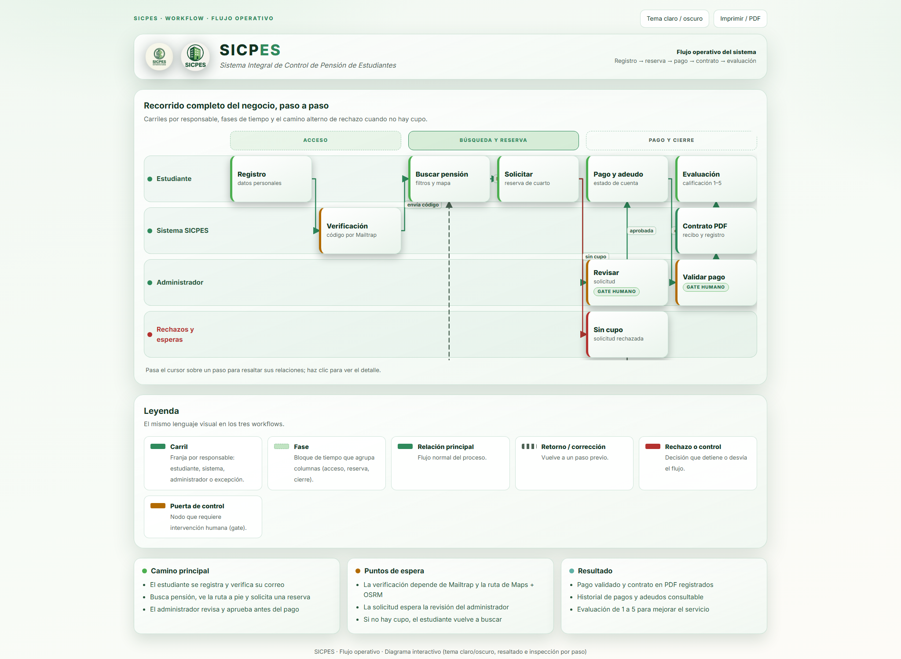
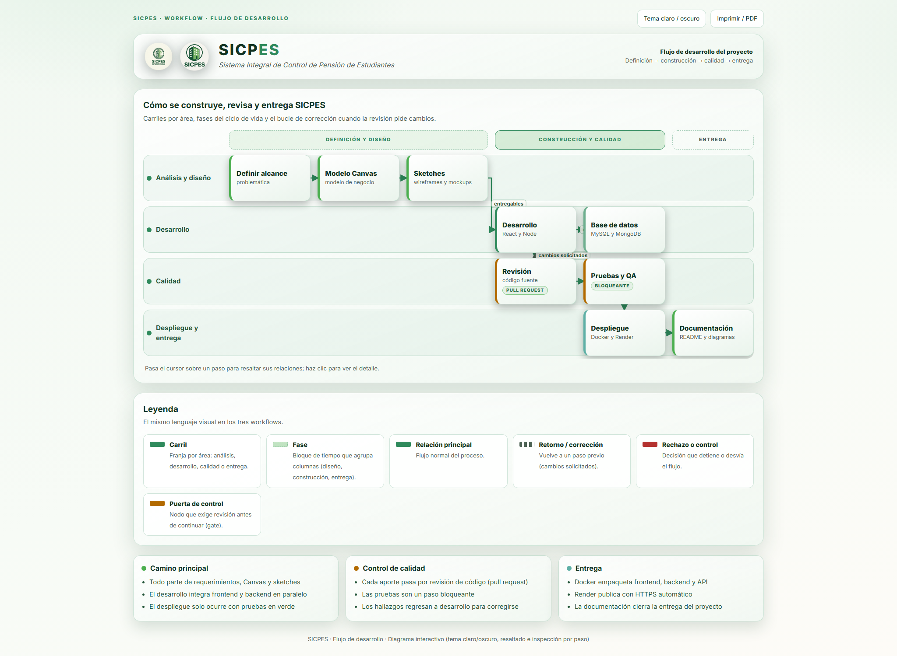
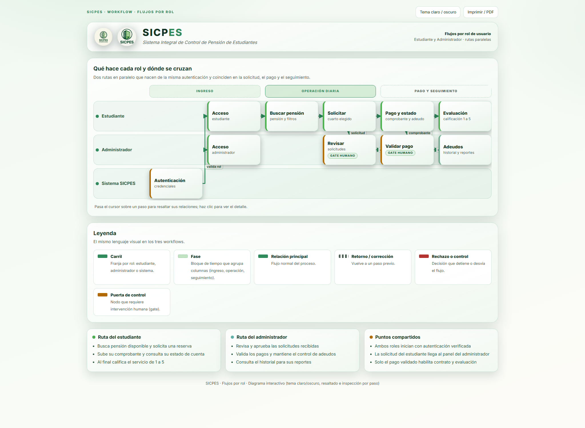
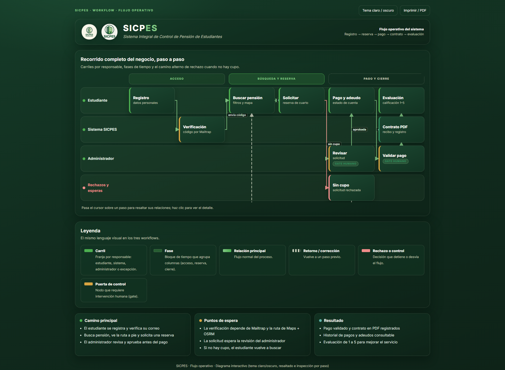

# <p align="center">SICPES · Workflows del sistema</p>

<p align="center">
  <strong>Sistema Integral de Control de Pensión de Estudiantes</strong><br>
  <em>Flujo operativo, flujo de desarrollo y flujos por rol · Diagramas interactivos con la identidad visual de SICPES</em>
</p>

<p align="center">
  
</p>

<p align="center">
  
</p>

<p align="center">
  <a href="flujo-operativo.html"><strong>▶ Ver el flujo operativo interactivo</strong></a>
  &nbsp;·&nbsp;
  <a href="flujo-desarrollo.html"><strong>▶ Ver el flujo de desarrollo</strong></a>
  &nbsp;·&nbsp;
  <a href="flujos-por-rol.html"><strong>▶ Ver los flujos por rol</strong></a>
</p>

## Contenido

1. [Resumen](#resumen)
2. [Flujo operativo del sistema](#flujo-operativo-del-sistema)
3. [Flujo de desarrollo del proyecto](#flujo-de-desarrollo-del-proyecto)
4. [Flujos por rol de usuario](#flujos-por-rol-de-usuario)
5. [Cómo leer los diagramas](#cómo-leer-los-diagramas)
6. [Temas y paleta de colores](#temas-y-paleta-de-colores)
7. [Cómo abrir y ver los diagramas](#cómo-abrir-y-ver-los-diagramas)
8. [Estructura de la carpeta](#estructura-de-la-carpeta)
9. [Versión alternativa (Archify)](#versión-alternativa-archify)

## Resumen

Esta carpeta concentra los **tres workflows** que describen cómo opera SICPES: quién hace qué,
en qué orden y con qué decisiones intermedias. Cada workflow es un diagrama **HTML interactivo
y autónomo** (SVG embebido) que se puede abrir sin servidor, con resaltado de relaciones por
paso, panel de detalle, cambio de tema claro/oscuro e impresión a PDF.

Los tres se construyeron en el **estilo de casa de SICPES**: la paleta oficial, la tipografía
Inter y los dos logotipos del proyecto (empresa y producto), igual que el
[diagrama de arquitectura](../DiagramaDeArquitectura/arquitectura.html) y el
[diagrama de roles de usuario](../RolesDeUsuario/diagrama-roles-usuario-sicpes.html).

| Workflow | Responde a la pregunta | Archivo |
| :--- | :--- | :--- |
| **Flujo operativo del sistema** | ¿Qué ocurre, paso a paso, desde que un estudiante se registra hasta que califica el servicio? | [flujo-operativo.html](flujo-operativo.html) |
| **Flujo de desarrollo del proyecto** | ¿Cómo se construye, revisa y entrega SICPES como producto de software? | [flujo-desarrollo.html](flujo-desarrollo.html) |
| **Flujos por rol de usuario** | ¿Qué hace el Estudiante y qué hace el Administrador, y dónde se cruzan? | [flujos-por-rol.html](flujos-por-rol.html) |

Los tres comparten el mismo lenguaje visual: **carriles** (una franja horizontal por responsable),
**fases** (bloques de tiempo que agrupan columnas), **nodos** (acciones y estados) y **tarjetas**
de conclusión al pie.

## Flujo operativo del sistema

Recorrido completo del negocio: registro y verificación del estudiante, búsqueda de pensión,
solicitud de reserva, revisión del administrador, pago, validación, contrato en PDF y evaluación
final. Incluye el **camino alterno de rechazo** cuando no hay cupo.

<p align="center">
  <a href="flujo-operativo.html">
    
  </a>
</p>

| Elemento | Valor |
| :--- | :--- |
| **Carriles** | Estudiante · Sistema SICPES · Administrador · Rechazos y esperas *(excepción)* |
| **Fases** | Acceso · Búsqueda y reserva *(énfasis)* · Pago y cierre *(entregable)* |
| **Camino principal** | Registro → Verificación → Buscar pensión → Solicitar → Revisar → Pago y adeudo → Validar pago → Contrato PDF → Evaluación |
| **Excepciones** | `sin cupo` (error) → **Sin cupo** → `busca otra opción` (retorno) → volver a **Buscar pensión** |
| **Servicios externos** | Mailtrap (código de verificación) y Maps + OSRM (ruta a pie y distancia), anotados sobre las relaciones |

## Flujo de desarrollo del proyecto

Ciclo de vida con el que se construye SICPES: definición del alcance, Canvas, sketches, desarrollo,
base de datos, revisión de código, pruebas y despliegue. El **bucle de corrección** de los hallazgos
se representa como una relación de retorno desde la revisión hacia el desarrollo.

<p align="center">
  <a href="flujo-desarrollo.html">
    
  </a>
</p>

| Elemento | Valor |
| :--- | :--- |
| **Carriles** | Análisis y diseño · Desarrollo · Calidad · Despliegue y entrega |
| **Fases** | Definición y diseño · Construcción y calidad *(énfasis)* · Entrega *(entregable)* |
| **Camino principal** | Definir alcance → Modelo Canvas → Sketches → Desarrollo → Revisión → Pruebas y QA → Despliegue → Documentación |
| **Bucle de corrección** | `cambios solicitados` (retorno) desde **Revisión** hacia **Desarrollo** |
| **Puertas de control** | Revisión de código (*pull request*) y pruebas **bloqueantes** antes de desplegar |

## Flujos por rol de usuario

Dos rutas en paralelo —Estudiante y Administrador— que nacen de la misma autenticación y se
encuentran en los puntos compartidos de solicitud, pago y seguimiento.

<p align="center">
  <a href="flujos-por-rol.html">
    
  </a>
</p>

| Elemento | Valor |
| :--- | :--- |
| **Carriles** | Estudiante · Administrador · Sistema SICPES |
| **Fases** | Ingreso · Operación diaria *(énfasis)* · Pago y seguimiento *(entregable)* |
| **Ruta del estudiante** | Acceso → Buscar pensión → Solicitar → Pago y estado → Evaluación |
| **Ruta del administrador** | Acceso → Revisar → Validar pago → Adeudos |
| **Puntos compartidos** | Autenticación común, solicitud que llega al panel del administrador y validación del pago |

## Cómo leer los diagramas

- **Carril (lane):** franja horizontal que representa a un responsable (rol, área o el sistema).
  El carril *Rechazos y esperas* del flujo operativo se distingue por color (variante *excepción*).
- **Fase (phase):** bloque superior que agrupa varias columnas y marca el momento del proceso.
  Las fases con variante *énfasis* (trazo sólido) y *entregable* (trazo discontinuo) se distinguen por color.
- **Nodo:** caja con un color de borde según su tipo semántico (interfaz, backend, datos, control,
  infraestructura, excepción). Una **etiqueta** señala puertas de control (*gate humano*, *pull request*, *bloqueante*).
- **Relación:** flecha ortogonal con una etiqueta de significado:
  - **principal** = flujo normal del proceso;
  - **retorno / corrección** (línea discontinua gris) = vuelve a un paso previo;
  - **rechazo o control** (rojo) = decisión que detiene o desvía el flujo.
- **Tarjetas:** resumen interpretativo al pie del diagrama (camino principal, control y resultado).
- **Interacción:** al pasar el cursor sobre un paso se resaltan todas sus relaciones y se atenúa el
  resto; al hacer clic se abre un panel con los pasos entrantes y salientes.
- **Leyenda:** incluida en la propia página, con el mismo lenguaje visual en los tres workflows.

## Temas y paleta de colores

Cada diagrama incluye **tema claro y oscuro** intercambiables desde la barra superior (el botón
*Tema claro / oscuro*), y también se puede fijar por URL con `?theme=light` o `?theme=dark`.

Paleta oficial de SICPES usada en los tres diagramas:

| Color | Hex | Uso |
| :--- | :--- | :--- |
| Verde bosque | `#2F8A5C` | Color principal / acentos fuertes |
| Verde | `#4CAF50` | Estados activos y confirmaciones |
| Verde claro | `#81C784` | Rellenos suaves y realce |
| Salvia | `#C7CCB9` | Texto secundario y separadores |
| Crema | `#FDFBF7` | Tinta sobre fondo oscuro / fondo base en claro |

<p align="center">
  
</p>

## Cómo abrir y ver los diagramas

**En local.** Abre directamente el archivo `.html` en tu navegador (Chrome, Edge o Firefox). Cada
archivo es autónomo: no necesita servidor (solo internet para cargar la tipografía Inter).

**En línea (GitHub Pages).** Si el sitio del repositorio está publicado, los diagramas quedan
disponibles en:

- `https://jffa25.github.io/SICPES_INTEGRADORA/workflow/flujo-operativo.html`
- `https://jffa25.github.io/SICPES_INTEGRADORA/workflow/flujo-desarrollo.html`
- `https://jffa25.github.io/SICPES_INTEGRADORA/workflow/flujos-por-rol.html`

## Estructura de la carpeta

```text
workflow/
├── README.md                       # este documento
├── flujo-operativo.html            # flujo operativo (estilo SICPES)
├── flujo-desarrollo.html           # flujo de desarrollo (estilo SICPES)
├── flujos-por-rol.html             # flujos por rol (estilo SICPES)
├── capturas/                       # imágenes usadas en este README
│   ├── flujo-operativo.light.png
│   ├── flujo-operativo.dark.png
│   ├── flujo-desarrollo.light.png
│   ├── flujo-desarrollo.dark.png
│   ├── flujos-por-rol.light.png
│   └── flujos-por-rol.dark.png
└── archify/                        # versión alternativa generada con la Skill Archify
    ├── flujo-operativo.html
    ├── flujo-desarrollo.html
    ├── flujos-por-rol.html
    ├── *.workflow.json             # fuentes (spec de Archify, schema_version: 2)
    ├── *.visual-check.json         # evidencia de navegador
    └── capturas/                   # capturas de la versión Archify
```

Los tres `*.html` de la raíz son la **entrega** en la identidad visual del proyecto. La carpeta
`archify/` conserva la **versión alternativa** generada con la Skill Archify (preset `classic`),
que se mantiene como referencia.

## Versión alternativa (Archify)

Antes del rediseño, los tres workflows se generaron con la Skill **Archify** a partir de fuentes
JSON (`*.workflow.json`). Esa versión sigue disponible en la carpeta [`archify/`](archify/).

> **Nota.** Archify no acepta colores hexadecimales propios ni logotipos: su contrato de autoría solo
> expone presets semánticos (`classic`, `signal-flow`, `blueprint`, `editorial`) y las variantes de
> significado de cada nodo y relación. Por eso la versión de `archify/` no usa la paleta oficial de
> SICPES, y el rediseño en la raíz se hizo directamente en HTML/CSS/SVG para respetar la identidad visual.

---

<p align="center"><sub>SICPES · Diagramas de workflow · Identidad visual propia · versión alternativa con Archify en <code>archify/</code></sub></p>
