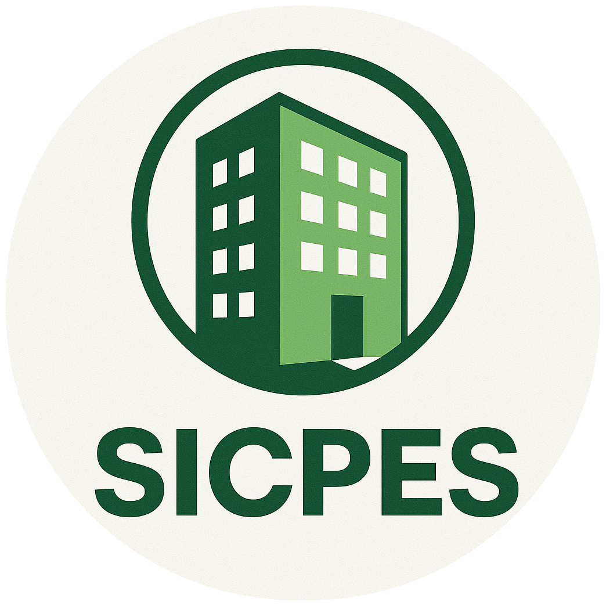
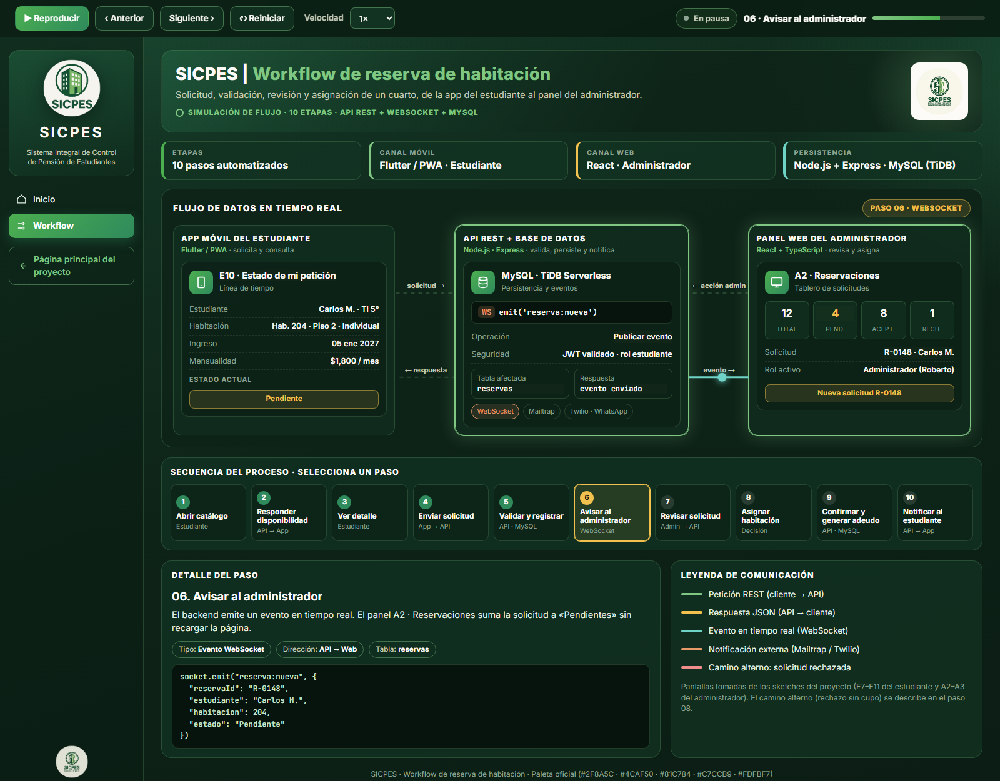
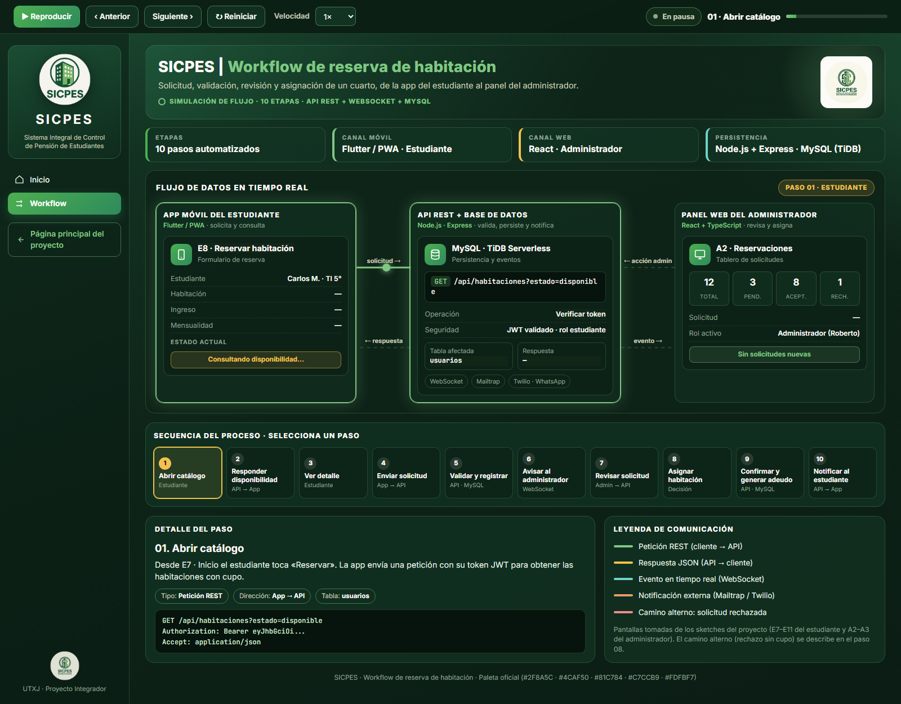
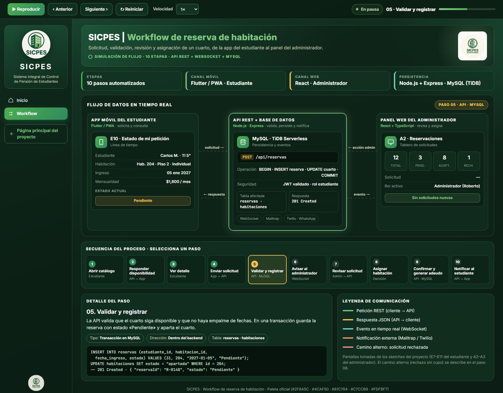
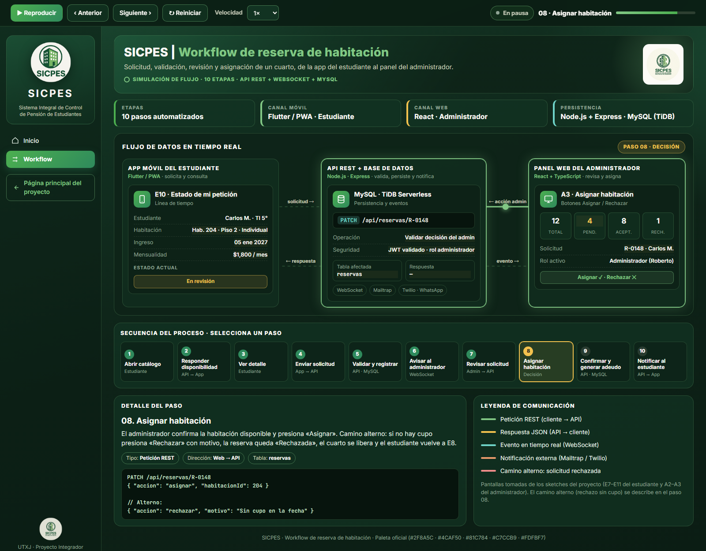
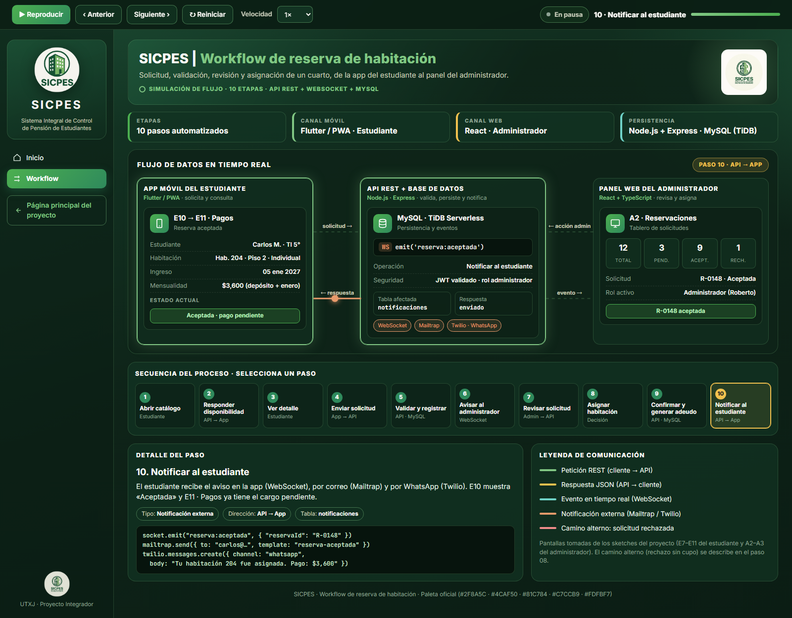

# <p align="center">SICPES · Workflow de reserva de habitación</p>

<p align="center">
  <strong>Sistema Integral de Control de Pensión de Estudiantes</strong><br>
  <em>Simulación animada del flujo de una función de la app: el estudiante reserva una habitación y el administrador la asigna</em>
</p>

<p align="center">
  
</p>

<p align="center">
  <a href="reserva-habitacion.html">
    
  </a>
</p>

<p align="center">
  <a href="reserva-habitacion.html"><strong>▶ Abrir el workflow animado</strong></a>
  &nbsp;·&nbsp;
  <a href="https://jffa25.github.io/SICPES_INTEGRADORA/workflow/reserva-habitacion.html"><strong>Ver en línea (GitHub Pages)</strong></a>
</p>

## Contenido

1. [¿Qué es este workflow?](#qué-es-este-workflow)
2. [Por qué el proceso de reserva](#por-qué-el-proceso-de-reserva)
3. [Participantes del flujo](#participantes-del-flujo)
4. [Las 10 etapas](#las-10-etapas)
5. [Camino alterno: solicitud rechazada](#camino-alterno-solicitud-rechazada)
6. [Cómo usar la simulación](#cómo-usar-la-simulación)
7. [Leyenda de comunicación](#leyenda-de-comunicación)
8. [Identidad visual](#identidad-visual)
9. [Fuente en formato Archify](#fuente-en-formato-archify)
10. [Estructura de la carpeta](#estructura-de-la-carpeta)
11. [Cambios respecto a la versión anterior](#cambios-respecto-a-la-versión-anterior)

## ¿Qué es este workflow?

Es un **workflow de servicio**: muestra, paso a paso y en tiempo real, cómo viajan los datos entre
las partes de SICPES cuando un estudiante **reserva una habitación**. No es un diagrama del negocio en
general, sino el flujo de **una función concreta de la app**, como pidió el docente.

La página es un HTML autónomo con animación: un paquete de datos recorre los cables entre la app
del estudiante, la API con su base de datos y el panel web del administrador. En cada etapa se ve
la pantalla activa, el endpoint que se llama, la tabla de MySQL afectada, el estado de la solicitud y
el JSON o SQL que se envía.

## Por qué el proceso de reserva

La reserva de habitación es el **proceso central de SICPES**: une a los dos roles principales
(Estudiante y Administrador), usa los dos canales (app móvil y web), pasa por la API, escribe en la
base de datos y dispara notificaciones. También resuelve uno de los problemas planteados en el
proyecto: el **empalme de reservaciones** (dar el mismo cuarto a dos personas).

## Participantes del flujo

| Carril | Tecnología | Pantallas | Qué hace en el flujo |
| :--- | :--- | :--- | :--- |
| **App móvil del estudiante** | Flutter / PWA | `E7` Inicio · `E8` Reservar · `E9` Detalle · `E10` Estado de mi petición · `E11` Pagos | Consulta habitaciones, envía la solicitud y sigue su estado. |
| **API REST + base de datos** | Node.js + Express · MySQL en TiDB Serverless | — | Valida el token JWT, revisa disponibilidad, guarda la reserva y emite eventos. |
| **Panel web del administrador** | React + TypeScript | `A2` Reservaciones · `A3` Asignar habitación | Recibe la solicitud en tiempo real, la revisa y la asigna o rechaza. |
| **Servicios externos** | WebSocket · Mailtrap · Twilio (WhatsApp) | — | Avisan al administrador y al estudiante. |

Las pantallas son las mismas de los [Sketches](../Sketches/README.md) y las tecnologías las del
[Diagrama de Arquitectura](../DiagramaDeArquitectura/README.md).

## Las 10 etapas

| # | Etapa | Dirección | Endpoint / evento | Tabla | Resultado |
| :---: | :--- | :--- | :--- | :--- | :--- |
| 01 | **Abrir catálogo** | App → API | `GET /api/habitaciones?estado=disponible` | `usuarios` (token) | El estudiante entra a `E8 · Reservar`. |
| 02 | **Responder disponibilidad** | API → App | `200 OK` con la lista | `habitaciones` | Se llenan los selectores de piso y número. |
| 03 | **Ver detalle** | App → API | `GET /api/habitaciones/204` | `habitaciones · servicios` | Ficha `E9` con precio y servicios. |
| 04 | **Enviar solicitud** | App → API | `POST /api/reservas` | `reservas` | Fecha de ingreso, modalidad, piso y número. |
| 05 | **Validar y registrar** | Dentro de la API | Transacción MySQL | `reservas · habitaciones` | Reserva **Pendiente** y cuarto apartado, sin empalmes. |
| 06 | **Avisar al administrador** | API → Web | WebSocket `reserva:nueva` | `reservas` | `A2` suma la solicitud a «Pendientes». |
| 07 | **Revisar solicitud** | Web → API | `GET /api/reservas/R-0148` | `reservas` | Estado **En revisión**, visible para el estudiante. |
| 08 | **Asignar habitación** | Web → API | `PATCH /api/reservas/R-0148` | `reservas` | Decisión del administrador (asignar o rechazar). |
| 09 | **Confirmar y generar adeudo** | Dentro de la API | Transacción MySQL | `reservas · habitaciones · adeudos` | Reserva **Aceptada**, cuarto ocupado y primer cargo creado. |
| 10 | **Notificar al estudiante** | API → App | WebSocket `reserva:aceptada` + Mailtrap + Twilio | `notificaciones` | `E10` muestra «Aceptada» y `E11` tiene el pago pendiente. |

<p align="center">
  
  
</p>
<p align="center">
  
  
</p>

## Camino alterno: solicitud rechazada

En la etapa **08**, si no hay cupo en la fecha pedida, el administrador presiona **Rechazar** y escribe
un motivo. La API cambia la reserva a **Rechazada**, libera el cuarto apartado y avisa al estudiante,
que vuelve a `E8 · Reservar` para elegir otra habitación. El detalle del paso 08 muestra también el
JSON de este camino.

## Cómo usar la simulación

| Control | Qué hace |
| :--- | :--- |
| **Pausar / Reproducir** (o barra espaciadora) | Detiene o reanuda la animación. |
| **Anterior / Siguiente** (o flechas ← →) | Avanza o retrocede una etapa. |
| **Reiniciar** | Vuelve a la etapa 01 y reproduce. |
| **Velocidad** | 0.5×, 1×, 1.5× o 2×. |
| **Secuencia del proceso** | Clic en cualquier etapa para saltar a ella. |
| **URL** | `?step=6&paused=1` abre directamente una etapa en pausa (útil para capturas). |

En pantallas pequeñas los tres carriles se apilan y se ocultan los cables; el resto funciona igual.
Respeta la preferencia de *movimiento reducido* del sistema.

## Leyenda de comunicación

| Color | Significado |
| :--- | :--- |
| Verde claro | Petición REST (cliente → API) |
| Ámbar | Respuesta JSON (API → cliente) |
| Turquesa | Evento en tiempo real (WebSocket) |
| Naranja | Notificación externa (Mailtrap / Twilio) |
| Rojo | Camino alterno: solicitud rechazada |

## Identidad visual

El workflow usa el **logo del producto** (barra lateral) y el **logo de la empresa** (encabezado), la
tipografía Inter y la paleta oficial de SICPES:

| Color | Hex | Uso en el workflow |
| :--- | :--- | :--- |
| Verde bosque | `#2F8A5C` | Botones, menú activo y etapas completadas |
| Verde | `#4CAF50` | Acciones principales e indicador «Animación activa» |
| Verde claro | `#81C784` | Carriles activos, cables de petición y acentos |
| Salvia | `#C7CCB9` | Texto secundario |
| Crema | `#FDFBF7` | Texto sobre fondo oscuro y fondo del logo de empresa |

## Fuente en formato Archify

En [`archify/reserva-habitacion.workflow.json`](archify/reserva-habitacion.workflow.json) está el mismo
flujo descrito en el formato de la Skill **Archify** (`schema_version: 2`, `diagram_type: workflow`):
carriles, fases, las 10 etapas como nodos, el camino principal y la relación de rechazo.

La página animada se construyó en HTML/CSS/SVG porque Archify genera diagramas estáticos con sus
propios presets de color y no admite la paleta ni los logotipos del proyecto. El JSON sirve para
regenerar una versión estática con Archify si se necesita.

## Estructura de la carpeta

```text
workflow/
├── README.md                          # este documento
├── reserva-habitacion.html            # workflow animado (entrega)
├── capturas/                          # imágenes de este README
│   ├── paso-01.png
│   ├── paso-05.png
│   ├── paso-06.png
│   ├── paso-08.png
│   └── paso-10.png
└── archify/
    └── reserva-habitacion.workflow.json   # fuente en formato Archify
```

## Cambios respecto a la versión anterior

La versión anterior tenía tres diagramas generales (flujo operativo, flujo de desarrollo y flujos
por rol) con su variante de Archify. Por indicación del docente, el workflow debe mostrar **el flujo de
una función de la app**, así que se reemplazaron por esta simulación de la **reserva de habitación**.
Los archivos anteriores se eliminaron de la carpeta y siguen disponibles en el historial de Git.

---

<p align="center"><sub>SICPES · Workflow de reserva de habitación · Identidad visual propia</sub></p>
